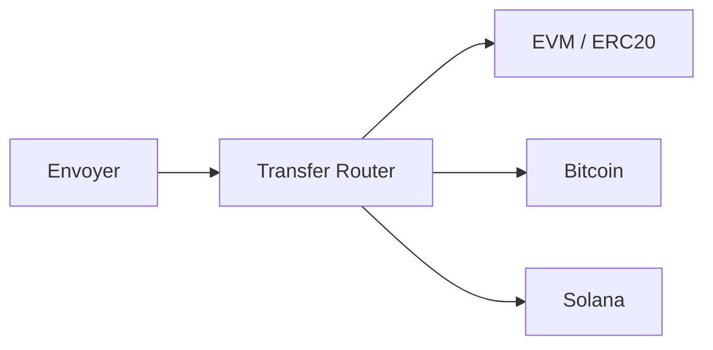

# 🏦 Banque IA-TB — V2.0 DEBUG

> **🟢 En simple : la Banque gère les wallets et les clés de l’utilisateur séparément du moteur de trading. Un wallet IA-TB peut contenir des comptes EVM, Bitcoin et Solana ; les secrets restent chiffrés côté serveur et ne sont déchiffrés que pour une action explicite.**

<p align="center">
  
</p>

---

## 👤 Wallets rattachés au client

**🟢 En simple : les wallets ne sont pas une liste globale partagée entre tous les utilisateurs. Ils sont rattachés à l’identité client résolue par Client Service.**

Le Wallet Service V2 utilise actuellement un schéma **version 3**. Les anciennes entrées peuvent être migrées vers la clé de stockage liée au `clientId`.

Un wallet public expose :
- ID ;
- nom ;
- type/kind ;
- réseaux ;
- adresses ;
- clés publiques ;
- présence ou non d’un secret.

La liste publique ne déchiffre pas la clé privée.

---

## 🌐 Wallet multi-chaînes

**🟢 En simple : lorsqu’IA-TB crée un wallet multi-chain, il crée trois comptes cryptographiques : un compte EVM partagé par plusieurs réseaux, un compte Bitcoin et un compte Solana.**

Réseaux actuels :

| Famille | Réseaux |
|---|---|
| EVM | Ethereum, Arbitrum, Polygon, BNB Chain, Base |
| Bitcoin | Bitcoin |
| Solana | Solana |

Le même compte/adresse EVM est réutilisé sur les réseaux EVM compatibles.

Bitcoin est généré en P2PKH avec récupération WIF compressée. Solana utilise une paire Ed25519 avec récupération Base58.

---

## 🔐 Chiffrement des secrets

**🟢 En simple : la clé privée n’est pas stockée en clair avec les informations du wallet.**

Le Wallet Service chiffre les secrets avec **AES-256-GCM** :
- IV aléatoire ;
- authentication tag ;
- master key locale persistante ;
- envelope chiffrée par compte.

La master key est stockée dans la zone de données persistantes avec permissions de fichier restrictives lorsque le système les supporte.

---

## ➕ Création / import

**🟢 En simple : créer ou importer un wallet demande une vérification utilisateur et une confirmation explicite.**

La création exige :
- nom ;
- mot de passe valide ;
- confirmation `notRobot=true` ;
- ID attendu non périmé.

L’import accepte :
- clé privée EVM ;
- WIF Bitcoin ;
- clé/keypair Solana selon formats acceptés.

> La case “humain” est une confirmation applicative, pas un CAPTCHA anti-bot robuste.

---

## 🔑 Mes Clés

**🟢 En simple : la section Mes Clés permet de voir les métadonnées, copier les adresses, révéler temporairement un secret et exporter une liste sans exporter les secrets.**

Fonctions actuelles :
- Ajouter ;
- Exporter ;
- Paramètres ;
- filtre Exchange / Hot / Cold ;
- recherche et tri ;
- révélation d’un secret ;
- suppression d’un secret d’une famille.

L’export annonce `secretsExcluded: true`.

La révélation d’un secret renvoie une fenêtre d’utilisation UI de **30 secondes**. Le secret n’est pas inclus dans la liste générale.

La barre **Ajouter / Exporter / Paramètres** est placée sous le tableau des clés, avant le tutoriel.

---

# 💸 Transferts

## 🧭 Router de transfert

**🟢 En simple : il n’existe pas un gros module qui essaie de comprendre tous les réseaux. Un Router choisit le module adapté au réseau.**



Le service `TRANSFER_V3_ROUTER` possède trois modules :
- `ERC20`
- `BITCOIN`
- `SOLANA`

Le registre d’actifs impose les compatibilités réseau.

---

## 🟦 EVM / ERC20

**🟢 En simple : Ethereum et les réseaux EVM peuvent envoyer la monnaie native ou un token ERC20 résolu.**

Réseaux : Ethereum, Arbitrum, Polygon, BNB Chain, Base.

Le module utilise `ethers` pour :
- lire le solde ;
- estimer les frais ;
- signer ;
- soumettre ;
- attendre la confirmation prévue par le module.

---

## 🟠 Bitcoin

**🟢 En simple : le réseau Bitcoin accepte actuellement uniquement BTC.**

Le module :
- utilise un endpoint Esplora compatible ;
- récupère les UTXO ;
- estime les frais ;
- sélectionne les UTXO ;
- construit une transaction ;
- signe localement les wallets source P2PKH actuels ;
- diffuse la transaction.

Les destinations P2PKH/P2SH/SegWit compatibles sont reconnues pour la construction de sortie.

**Limite actuelle :** le signer source est conçu pour les wallets P2PKH générés par IA-TB. Le statut après broadcast est `SUBMITTED`, pas une fausse confirmation.

---

## 🟣 Solana

**🟢 En simple : le réseau Solana accepte actuellement uniquement SOL natif.**

Le module :
- récupère le blockhash ;
- construit un transfert System Program ;
- demande les frais réels avec `getFeeForMessage` ;
- contrôle le solde ;
- signe en Ed25519 ;
- envoie avec `sendTransaction`.

Les tokens SPL ne sont pas encore activés.

Le statut après soumission est `SUBMITTED`.

---

## ✅ Allowlist

**🟢 En simple : sélectionner un token dans CoinGecko ne signifie pas qu’il est automatiquement transférable sur n’importe quel réseau.**

Règles :
- Bitcoin → BTC uniquement ;
- Solana → SOL uniquement ;
- EVM → native + ERC20 lorsque le contrat réseau est résolu.

Le backend applique la règle même si l’UI est contournée.

---

# 🔄 Swap & Bridge

## 🌉 Fonctionnement

**🟢 En simple : Swap/Bridge est aujourd’hui un module EVM distinct des transferts BTC/SOL. Il demande plusieurs routes à 0x Cross-Chain, vérifie les soldes/frais, puis signe côté Banque.**

Réseaux actuels :
- Ethereum ;
- Arbitrum ;
- Polygon ;
- BNB Chain ;
- Base.

Provider : **0x Cross-Chain**.

Le service :
1. construit le contexte wallet/réseaux/tokens ;
2. demande les quotes ;
3. calcule/range les routes ;
4. vérifie balance token et gas ;
5. prépare allowance si nécessaire ;
6. signe avec le secret du Wallet Service ;
7. soumet l’origine ;
8. attend une confirmation d’origine ;
9. suit le statut cross-chain.

Une commission IA-TB de **1 % / 100 bps** est actuellement intégrée au service et nécessite un fee recipient configuré.

---

## 👁️ OnChain Reader

**🟢 En simple : la Banque possède aussi un lecteur blockchain READ_ONLY, mais sa couverture actuelle est principalement EVM.**

Fonctions actuelles :
- identité wallet ;
- solde natif EVM ;
- transaction count ;
- latest block ;
- transaction par hash ;
- receipt ;
- historique local IA-TB des transferts/swap.

Limite : un RPC EVM standard ne donne pas efficacement tout l’historique d’une adresse ; un indexer externe serait nécessaire pour un historique complet.

---

## 🏦 Vaults, Pools, Loans

**🟢 En simple : toutes les cartes affichées dans Banque ne représentent pas forcément un service financier déjà exécutable.**

- Wallets / Keys : fonctions réelles intégrées ;
- Transferts : EVM/BTC/SOL intégrés, confirmation BTC/SOL à compléter ;
- Swap/Bridge : EVM intégré, configuration RPC/0x requise ;
- Vault registry : infrastructure présente ;
- Pools / Earn / Loans : plusieurs blocs restent **prévu / conception / placeholder**.

Le Wiki doit continuer à distinguer l’interface préparée du service réellement exécutable.

---

## 🔐 Principe de sécurité

**🟢 En simple : l’IA peut demander une action, mais elle ne doit jamais recevoir la clé privée du wallet.**

```text
Demande utilisateur / service
   → Wallet Service
   → contrôle mot de passe / confirmation
   → déchiffrement local ciblé
   → signature
   → secret effacé de la variable
   → soumission réseau
```

La révélation manuelle d’une clé est une fonction distincte de la signature d’une transaction.
