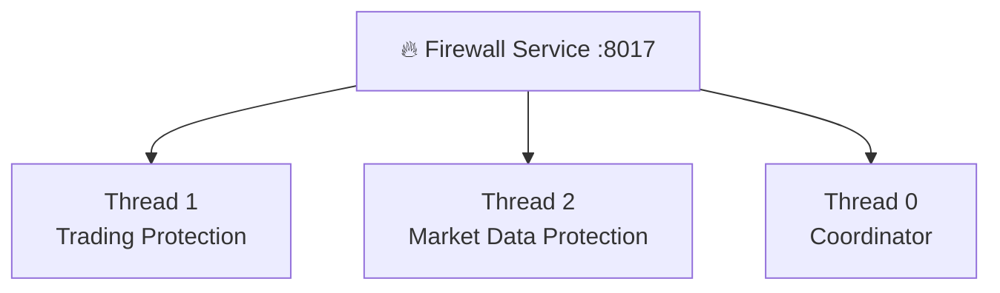

# 🔥 Firewall IA-TB — Trading + Market Data

> **🟢 En simple : le Firewall protège deux frontières différentes : les ordres avant Trading Engine et les données avant qu’elles soient considérées comme valides par le reste de l’application.**

Le service Firewall écoute sur **8017** et agit comme coordinateur de plusieurs workers de protection.

---

## 🧱 Architecture

**🟢 En simple : un même service héberge plusieurs protections spécialisées plutôt qu’un seul filtre générique.**

Workers déclarés :
- Thread 0 — Router Firewall / coordination ;
- Thread 1 — Trading Engine Protection ;
- Thread 2 — Market Data Collector Protection.



---

# ⚡ Trading Firewall

## 🎯 Rôle

**🟢 En simple : avant qu’un ordre arrive à Trading Engine, le Firewall vérifie que la commande est authentifiée, récente, autorisée, non dupliquée et couverte par une autorisation Risk.**

Contrôles par défaut :
- authentification CP ;
- signature du message ;
- timestamp ;
- âge maximal ;
- whitelist de commandes ;
- whitelist de paires ;
- protection anti-doublon ;
- Risk Gate.

---

## ✅ Commandes autorisées

**🟢 En simple : le Firewall refuse une action Trading qui n’est pas explicitement prévue.**

Whitelist par défaut :
- `trading.execute`
- `trading.cancel`
- `trading.close_position`
- `trading.health`
- `trading.capabilities`
- `trading.history`

Paires de démonstration/configuration par défaut du fichier de règles :
- `BTC/EUR`
- `BTC/USDT`
- `ETH/EUR`

Cette liste est un paramètre de sécurité, pas la liste de tous les marchés techniquement supportables.

---

## 🎟️ Risk Gate obligatoire

**🟢 En simple : même si la requête passe les autres contrôles, une opération mutante n’est pas transmise sans `risk_approval_id` valide.**

Le Firewall appelle `risk.gate.verify`. Une autorisation valide est consommée avant forward.

Même lorsque la protection générale Firewall est placée en bypass, les mutations Trading restent bloquées si le Risk Gate ne peut pas être garanti.

---

## 🔏 Forward interne

**🟢 En simple : Trading Engine vérifie que la commande vient réellement du Firewall et non d’un processus qui imite son URL.**

Le Firewall ajoute un marqueur interne et une signature HMAC. Trading Engine recalcule cette signature avant d’accepter `execute`, `cancel` ou `close_position`.

---

# 📡 Market Data Firewall

## 🎯 Rôle

**🟢 En simple : les données externes sont considérées comme non fiables jusqu’à ce que leur format et leur provenance aient été vérifiés.**

Le Data Firewall contrôle :
- taille du payload ;
- provider ;
- type de donnée ;
- provenance ;
- timestamp / fraîcheur ;
- symbole ;
- invariants OHLC ;
- prix positifs ;
- bid/ask ;
- spread ;
- doublons ;
- mouvements de prix anormaux.

---

## 📈 Mouvement de prix important

**🟢 En simple : un gros mouvement réel ne doit pas être supprimé uniquement parce qu’il est inhabituel.**

Le contrôle `priceJump` produit actuellement un **warning** lorsqu’une variation excède la référence configurée. Il ne transforme pas automatiquement cette variation en fausse donnée si les autres validations passent.

---

## 🦎 CoinGecko / 🦙 DeFiLlama

**🟢 En simple : les snapshots financiers provenant de CoinGecko et DeFiLlama passent eux aussi par le Data Firewall avant d’être stockés par Market Data.**

Le Financial Collector envoie un envelope contenant :
- provider ;
- provenance ;
- type `MARKET_ANALYTICS` ;
- timestamp ;
- données.

Un rejet Firewall retire la famille concernée du snapshot plutôt que de la publier silencieusement.

---

## 👀 Protection vs Observation

**🟢 En simple : en mode Protection une violation bloque ; en mode Observation elle peut être signalée sans bloquer, afin de diagnostiquer les règles.**

Cette distinction existe pour les workers de protection. Les contrôles de sécurité critiques du chemin Trading restent conçus pour empêcher un contournement de l’autorisation Risk.

---

## 🛠️ Administration

**🟢 En simple : l’Admin peut observer les threads, les recharger ou modifier leur activation dans les limites prévues, sans disposer d’un shell arbitraire.**

Le panneau Admin expose les statuts et événements Firewall. Les opérations de gestion restent réservées à l’accès Admin.

---

## 🔐 Résumé

```text
DATA:
Provider → Market Data → Data Firewall → données validées → Router

TRADING:
Intention → Risk Gate → Router → Trading Firewall
          → Risk verify → forward signé → Trading Engine → Exchange
```
