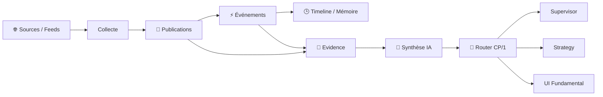

# 🧭 Fundamental Engine V3 — V2.0 DEBUG

> **🟢 En simple : Fundamental Engine collecte et organise les informations extérieures au graphique — actualités, événements, sources et contexte — puis peut demander une synthèse IA. Il informe les décisions mais n’exécute jamais un trade.**

Le service est **ACTIVE** sur **8015**, communique en **CP/1** et reste explicitement en mode **INFORMATION_ONLY**.

---

## 🎯 Rôle

**🟢 En simple : ce moteur transforme un flux de publications en contexte vérifiable, avec sources, preuves et chronologie.**

Fundamental V3 couvre notamment :
- sources et feeds ;
- collecte RSS / Atom / Web selon providers configurés ;
- publications brutes ;
- événements structurés ;
- evidence ;
- mémoire temporelle / timeline ;
- recherche ;
- diagnostics ;
- synthèses IA à la demande ;
- observability et logs privés.

Il ne modifie pas une stratégie à lui seul.

---

## 🧠 Principe INFORMATION_ONLY

**🟢 En simple : “news haussière” ne signifie pas “acheter”.**

Le moteur peut produire :
- information ;
- contexte ;
- sentiment/biais descriptif ;
- synthèse ;
- événement ;
- niveau de confiance.

Mais l’utilisation de cette information appartient ensuite à Strategy/Supervisor/Risk. Fundamental ne possède pas de chemin d’exécution vers l’exchange.

---

## 🔄 Pipeline

---

## 📰 News et événements

**🟢 En simple : une publication brute et un événement confirmé ne sont pas la même chose.**

Le moteur sépare :
- `fundamental.news` ;
- `fundamental.event` ;
- `fundamental.evidence`.

La recherche peut filtrer par :
- asset ;
- catégorie ;
- source/feed ;
- grade ;
- fiabilité ;
- importance ;
- dates ;
- limite.

Cette séparation évite de présenter une seule publication comme une vérité consolidée.

---

## 🕒 Mémoire temporelle

**🟢 En simple : le moteur essaie de comprendre comment une histoire évolue dans le temps, au lieu de considérer chaque article comme totalement indépendant.**

Les commandes Timeline permettent :
- lecture d’une timeline ;
- récupération du contexte ;
- reconstruction.

Le modèle V3 conserve les éléments nécessaires à la nouveauté et à la continuité d’un événement.

---

## 🤖 Synthèses IA

**🟢 En simple : la synthèse IA résume des éléments déjà collectés ; elle ne remplace pas les sources.**

Synthèses disponibles :
- news ;
- événement ;
- marché ;
- historique de synthèses.

La page Fundamental peut demander une nouvelle synthèse mais doit conserver les éléments utilisés et le caractère informationnel du résultat.

---

## 🔎 Sources, providers et découverte

**🟢 En simple : les sources ne sont pas codées comme une seule liste figée dans l’interface. Le moteur possède un registre et des outils de diagnostic.**

Fonctions :
- recherche de sources ;
- recherche de feeds ;
- état providers ;
- diagnostic feed ;
- diagnostic d’un brouillon ;
- inspection/préparation/test d’un candidat de découverte.

Cela permet d’ajouter progressivement de nouvelles sources sans transformer chaque provider en logique spéciale dans l’UI.

---

## 📋 Commandes CP/1 importantes

- `fundamental.health`
- `fundamental.status`
- `fundamental.capabilities`
- `fundamental.news.search`
- `fundamental.news.get`
- `fundamental.events.search`
- `fundamental.event.get`
- `fundamental.event.evidence`
- `fundamental.sources.search`
- `fundamental.collect`
- `fundamental.synthesis.*`
- `fundamental.timeline.*`
- `fundamental.providers.status`
- `fundamental.diagnostic.*`
- `fundamental.discovery.*`
- `fundamental.logs.*`

---

## 🖥️ Page Fundamental

**🟢 En simple : la page donne une vue humaine de ce que le moteur sait et de l’état de ses sources.**

Sections :
- Vue d’ensemble ;
- News & Événements ;
- Analyse IA ;
- Sources & Providers ;
- Domaines & DeFi ;
- Source Manager ;
- Collecte & Scheduler ;
- Diagnostics ;
- Observability ;
- Fundamental Console.

La navigation latérale utilise le style commun IA-TB inspiré de Banque.

---

## 🔐 Limite

**🟢 En simple : une synthèse Fundamental peut influencer une réflexion, jamais contourner Strategy, Risk ou Firewall.**

Le contrat protocolaire décrit Fundamental comme moteur canonique d’information avec comme consommateur métier principal le Supervisor et comme outils de gestion/diagnostic l’Admin via Router/CP1.
