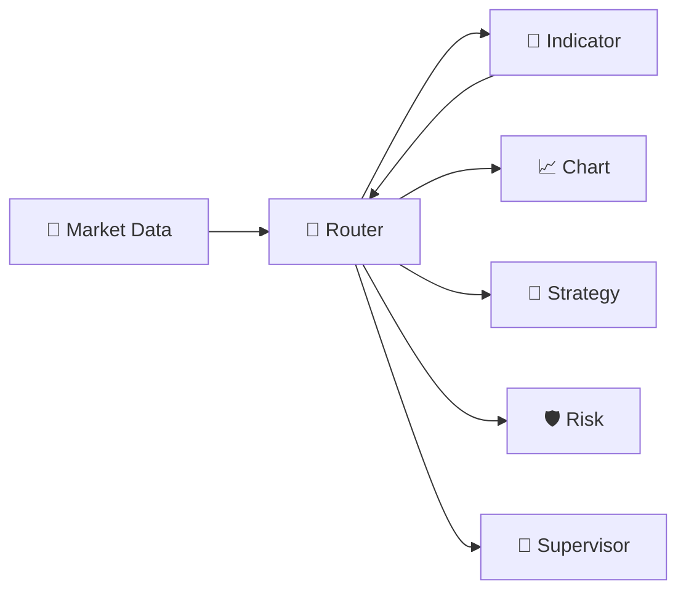

# 📐 Indicator Engine — V2.0 DEBUG

> **🟢 En simple : Indicator Engine transforme des données de marché en indicateurs techniques. Il peut utiliser les chandeliers classiques, mais aussi certaines séries financières provenant du Market Data Collector.**

Le service écoute sur **8012** et communique en **CP/1**.

---

## 🎯 Rôle

**🟢 En simple : Market Data fournit les données brutes ; Indicator les transforme en RSI, EMA et autres mesures exploitables par le graphique, Strategy, Risk ou Supervisor.**

Le moteur conserve le contexte de calcul :
- symbole ;
- timeframe ;
- source ;
- chandeliers ;
- paramètres de l’indicateur.

Il ne passe aucun ordre.

---

## 📚 Catalogue d’indicateurs

**🟢 En simple : les indicateurs ne sont plus uniquement des fonctions codées en dur ; IA-TB possède un registre et un petit langage de définition.**

Le moteur expose notamment :
- `indicator.list_indicators`
- `indicator.definition.get`
- `indicator.definition.validate`
- `indicator.definition.create`

Les indicateurs BuiltIn sont protégés et les Custom peuvent être gérés depuis l’interface Paramètres.

---

## ✍️ IIL — Indicator Language

**🟢 En simple : IIL permet de décrire un indicateur avec une syntaxe IA-TB plus simple que modifier directement le moteur.**

Commandes :
- `indicator.language.info`
- `indicator.language.validate`
- `indicator.language.compile`
- `indicator.language.create`

Le code source IIL est validé/compilé vers la représentation interne du moteur avant utilisation.

---

## 🧮 Calculs

**🟢 En simple : un appel peut demander un indicateur ou plusieurs indicateurs en une seule fois.**

Le moteur expose :
- `indicator.compute`
- `indicator.compute_batch`
- `indicator.compute_data`
- `indicator.compute_batch_data`
- `indicator.analyze`
- `indicator.get_levels`
- `indicator.get_signals`
- `indicator.get_state`

Les variantes `*_data` acceptent directement un lot de chandeliers fourni par le consommateur. Les autres peuvent travailler avec le contexte Market Data prévu par le runtime.

---

## 💰 Séries financières

**🟢 En simple : Indicator peut également analyser l’évolution de métriques comme TVL ou volumes issus du snapshot financier central.**

Commandes :
- `indicator.financial_context`
- `indicator.financial_series`
- `indicator.financial_analyze`

`financial_analyze` peut calculer :
- variation ;
- min / max ;
- moyenne ;
- SMA ;
- EMA.

La donnée reste issue de Market Data ; Indicator ne crée pas son propre provider CoinGecko/DeFiLlama.

---

## 🔄 Flux

**🟢 En simple : les mêmes données validées peuvent alimenter le graphique, Strategy et Supervisor sans recalculer une source différente pour chacun.**

---

## ✅ Reproductibilité

**🟢 En simple : un indicateur n’a de sens que si l’on sait exactement avec quelles données il a été calculé.**

Les calculs doivent toujours conserver ou permettre de retrouver :
- provider/source ;
- symbole ;
- timeframe ;
- paramètres ;
- données ou fenêtre utilisée.

Un indicateur volume ne doit pas mélanger silencieusement le volume d’une autre plateforme.
