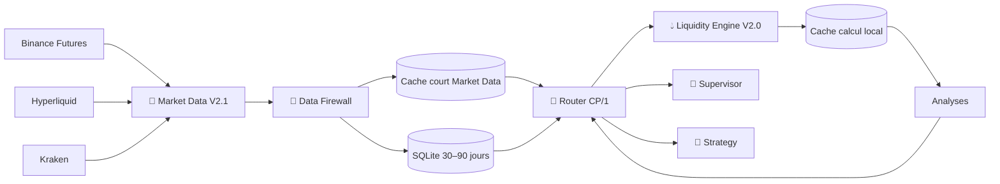

# 💧 Liquidity Engine V2.0 — V2.0 DEBUG

> **🟢 En simple : Liquidity Engine ne se connecte plus à Internet. Il reçoit uniquement des données déjà collectées par Market Data, contrôlées par le Data Firewall et transportées par Router/CP1. Son travail est maintenant uniquement d’analyser la liquidité, de mettre en cache les données utiles aux calculs et de produire des résultats pour Strategy, Supervisor, Portfolio ou l’UI.**

Le service écoute sur **8014**.

---

## 🧱 Architecture

**🟢 En simple : un seul composant collecte les données de marché externes : Market Data. Liquidity ne possède plus de connecteur Binance/Hyperliquid/Kraken actif.**



Le vieux provider direct `Liquidity/Provider/realtime_liquidity_provider.js` est désormais un **stub de compatibilité sans accès réseau**.

---

## 🌐 Providers microstructure migrés dans Market Data

**🟢 En simple : les API autrefois appelées directement par Liquidity ont été déplacées dans Market Data Collector.**

| Provider | Données |
|---|---|
| Binance Futures | carnet L2 + Open Interest |
| Hyperliquid | carnet L2 + Open Interest / mark price |
| Kraken | carnet L2 |

Les liquidations possèdent déjà un type Firewall réservé, mais aucun flux automatique de liquidation n’est encore branché dans cette migration.

---

## 🔥 Contrôles Data Firewall

**🟢 En simple : une donnée de carnet n’est jamais mise en cache ou en SQL avant d’avoir passé quelques règles simples de cohérence.**

Le type `LIQUIDITY_SNAPSHOT` vérifie notamment :
- provider autorisé ;
- type autorisé ;
- provenance ;
- timestamp/fraîcheur ;
- symbole ;
- taille du payload ;
- carnet non vide ;
- prix positifs ;
- tailles non négatives ;
- carnet non croisé ;
- best bid / best ask ;
- spread maximal ;
- Open Interest non négatif ;
- anti-duplicate.

Un rejet Firewall empêche le snapshot d’entrer dans le cache et l’historique SQL.

---

## 💾 Stockage

### Market Data — long terme

**🟢 En simple : l’historique brut validé est conservé par le Collector, pas par Liquidity Engine.**

Base :
`Shared Data/MarketData/liquidity_history.db`

Table :
`liquidity_snapshots`

Réglages :
- persistance par contexte : **60 s** par défaut ;
- rétention configurable : **30 à 90 jours** ;
- défaut actuel : **90 jours** ;
- index provider/symbol/timestamp.

### Liquidity Engine — court terme

**🟢 En simple : Liquidity garde seulement ce dont il a besoin pour recalculer rapidement.**

Caches locaux :
- zones : ~10 s ;
- raw validé : ~5 s ;
- analyse : ~3 s.

Le cache local n’est pas la mémoire historique officielle.

---

## 📊 Calculs disponibles

**🟢 En simple : Liquidity transforme un carnet brut en informations directement exploitables par une IA ou une stratégie.**

### Carnet
- best bid ;
- best ask ;
- mid price ;
- spread ;
- spread en bps ;
- quantité Bid / Ask ;
- notionnel Bid / Ask ;
- VWAP ;
- Bid/Ask ratio ;
- imbalance ;
- côté dominant.

### Profondeur
Le moteur calcule la liquidité disponible autour du prix à :
- **±10 bps** ;
- **±25 bps** ;
- **±50 bps** ;
- **±100 bps**.

Chaque bande contient Bid, Ask, total et imbalance.

### Impact d’exécution
Simulation actuelle pour :
- 1 000 $ ;
- 10 000 $ ;
- 100 000 $ ;
- 1 000 000 $.

Résultats :
- prix moyen ;
- montant rempli ;
- taux de remplissage ;
- impact/slippage en bps ;
- profondeur suffisante ou non.

### Open Interest / stress
- OI base ;
- mark price ;
- OI notionnel ;
- ratio **OI / profondeur ±100 bps**.

Ce ratio donne un indicateur de tension entre exposition dérivée et profondeur immédiate.

### Liquidity Score
**🟢 En simple : le score synthétise spread, profondeur et équilibre du carnet. Il est heuristique, pas une vérité de marché.**

Score 0–100, grade A→E :
- 35 % spread ;
- 45 % profondeur ±100 bps ;
- 20 % équilibre Bid/Ask.

Le résultat est explicitement marqué `estimated: true`.

---

## 🎯 Zones estimées

**🟢 En simple : les zones historiques restent calculées depuis les chandeliers validés de Market Data.**

Liquidity utilise OHLCV via CP/1 pour calculer :
- pivots hauts/bas ;
- ATR ;
- volume relatif ;
- nombre de touches ;
- récence ;
- proximité ;
- force de zone.

Elles restent marquées comme **zones probabilistes**, différentes de vraies liquidations observées.

---

## 🧾 Actions CP/1

- `liquidity.health`
- `liquidity.capabilities`
- `liquidity.zones`
- `liquidity.raw`
- `liquidity.history`
- `liquidity.realtime`
- `liquidity.snapshot`
- `liquidity.context`
- `liquidity.financial`
- `liquidity.liquidations`
- `liquidity.cache.clear`

---

## 🤖 Supervisor

**🟢 En simple : le Supervisor reçoit un résumé compact au lieu de tout le carnet brut.**

`liquidity.context` fournit notamment :
- mid price ;
- spread ;
- imbalance ;
- profondeur 10/25/50/100 bps ;
- Open Interest notionnel ;
- ratio OI/profondeur ;
- Liquidity Score ;
- impact d’exécution ;
- liquidations disponibles ;
- zones proches ;
- état Firewall / qualité.

Le Supervisor utilise désormais une source Liquidity indépendante (`AUTO` par défaut) de la source Candle du graphique.

---

## 🔐 Règle fondamentale

**🟢 En simple : Liquidity analyse ; Market Data collecte.**

```text
Internet
  ↓
Market Data
  ↓
Data Firewall
  ↓
Cache / SQLite
  ↓
Router CP/1
  ↓
Liquidity Engine
  ↓
Analyse / contexte Supervisor
```

Aucune API de marché externe ne doit être ajoutée directement dans Liquidity Engine.


---

## 🌐 OI multi-venue et liquidations

**🟢 En simple : Liquidity ne contacte aucune plateforme. Il demande au Market Data Collector l’OI couvert de la paire et les statistiques du flux de liquidations déjà validé.**

Nouvelles lectures :
- `liquidity.open_interest` → OI CEX + DEX + total couvert + couverture ;
- `liquidity.open_interest.history` → historique SQL du Collector ;
- `liquidity.liquidations` → statistiques sur les événements validés ;
- `liquidity.context` inclut l’agrégat OI pour le Supervisor.

L’analyse temps réel peut réunir :
1. carnet d’une venue sélectionnée ;
2. profondeur / spread / slippage ;
3. OI de cette venue ;
4. **OI couvert multi-venue** ;
5. flux de liquidations multi-venue ;
6. zones historiques estimées.

Cela permet au Supervisor de comparer la liquidité locale d’un marché avec le levier agrégé observé ailleurs sans confondre les sources.
