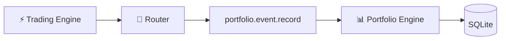

# 📊 Portfolio Engine — V2.0 DEBUG

> **🟢 En simple : Portfolio est la mémoire financière d’IA-TB. Il reçoit ce que Trading a réellement fait, reconstruit les positions, calcule les statistiques et conserve un historique pour l’interface et les autres Engines.**

Le service écoute sur **8020**.

---

## 🧠 Rôle

**🟢 En simple : Strategy peut proposer et Trading peut exécuter ; Portfolio est le composant qui se souvient du résultat.**

Il gère :
- événements d’exécution ;
- balances ;
- positions ;
- snapshots ;
- historique d’equity ;
- statistiques ;
- trades ;
- santé d’une position ;
- coûts d’utilisation IA.

---

## 💾 Stockage

**🟢 En simple : les données Portfolio ne dépendent pas de la mémoire du navigateur. Elles sont persistées par le service.**

Le moteur utilise un **store SQLite** hors de l’interface. Les réglages Portfolio sont eux aussi persistés.

Le service ferme proprement le store au shutdown et force un snapshot avant arrêt.

---

## ⚡ Alimentation par Trading

**🟢 En simple : le Portfolio ne devine pas les trades depuis les boutons de l’interface ; il reçoit les événements normalisés du Trading Engine.**

Chaque événement peut être dédupliqué/reconstruit par le moteur.

---

## 🔄 Resynchronisation Trading

**🟢 En simple : après une coupure, Portfolio peut demander à Trading les événements qui lui manquent.**

La commande `portfolio.sync` interroge `trading.history` via Router et réinjecte les événements absents.

Cela permet de limiter le risque de trou d’historique après redémarrage.

---

## 💹 Mark prices

**🟢 En simple : Portfolio rafraîchit les prix utiles pour mettre à jour le PnL des positions connues.**

Le runtime actuel rafraîchit explicitement les mark prices par Router pour les positions **Kraken** et **GMX**. Les autres chemins pourront être élargis à mesure que les adapters Portfolio sont complétés.

---

## 📦 Commandes CP/1

- `portfolio.health`
- `portfolio.event.record`
- `portfolio.balance.record`
- `portfolio.snapshot`
- `portfolio.positions`
- `portfolio.balances`
- `portfolio.history`
- `portfolio.statistics`
- `portfolio.events`
- `portfolio.sync`
- `portfolio.cost.summary`
- `portfolio.cost.history`
- `portfolio.position.health`
- `portfolio.trades`
- `portfolio.trade.detail`

---

## 💰 Coûts IA

**🟢 En simple : Portfolio peut aussi servir de point de consultation pour les coûts de consommation IA mesurés localement.**

Les commandes `portfolio.cost.summary` et `portfolio.cost.history` lisent le Usage Ledger et peuvent filtrer par Engine/catégorie/date.

---

## 🖥️ Page Portfolio

**🟢 En simple : la page web affiche les données calculées par le moteur Portfolio, elle ne reconstruit plus elle-même toute la comptabilité.**

Elle utilise notamment :
- `/portfolio-api/api/overview`
- `/portfolio-api/api/history`
- `/portfolio-api/api/trades`
- `/portfolio-api/api/trade`
- `/portfolio-api/health`

Le rafraîchissement de l’overview suit le réglage `pnlRefreshSec`, 3 secondes par défaut.

---

## ⚙️ Réglages observés

**🟢 En simple : les fréquences sont configurables pour équilibrer réactivité et charge machine.**

Valeurs par défaut :
- snapshot : 300 s ;
- PnL : 3 s ;
- sync exchange/trading : 30 s ;
- changement equity déclencheur : 1 % ;
- devise : EUR ;
- rétention snapshot : AUTO.

---

## 🔐 Source de vérité

**🟢 En simple : l’UI peut afficher “ordre envoyé”, mais l’historique Portfolio doit reposer sur les événements d’exécution normalisés et persistés.**

C’est ce découplage qui permet au Supervisor, Risk et à l’interface de partager une même mémoire financière.
