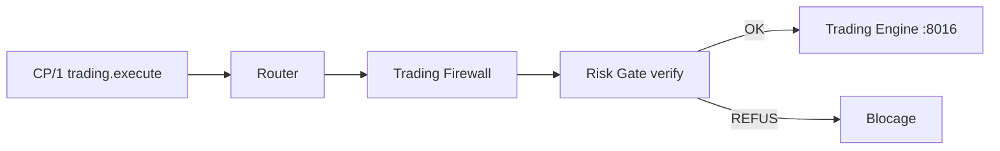

# 🔀 Router Protocol / CP/1 — V2.0 DEBUG

> **🟢 En simple : CP/1 est la langue commune des moteurs IA-TB et le Router est leur standard téléphonique. Un moteur indique une cible et une action ; le Router vérifie puis transmet la demande.**

---

## 🎯 Rôle

**🟢 En simple : le Router empêche l’application de devenir un réseau de connexions directes impossibles à contrôler.**

Le Communication Router écoute sur **127.0.0.1:8021**. Il assure :
- l’enregistrement des composants ;
- le routage requête/réponse ;
- la publication d’événements ;
- l’exposition des capacités ;
- le registre protocolaire ;
- les contrôles d’accès ;
- la séparation entre UI et appels internes.

---

## 🧱 Composants CP/1 actuels

**🟢 En simple : contrairement à l’ancien Wiki v1.8.12, Strategy Engine et IA Supervisor ne sont plus RESERVED : ils possèdent désormais un runtime actif.**

| Composant | État V2.0 DEBUG | Transport |
|---|---|---|
| Market Data | ACTIVE | CP/1 |
| Indicator | ACTIVE | CP/1 |
| Liquidity | ACTIVE | CP/1 |
| Fundamental | ACTIVE · INFORMATION_ONLY | CP/1 |
| Strategy Engine v2 | ACTIVE · INTENTION_ONLY | CP/1 |
| Risk Engine | ACTIVE | CP/1 |
| Portfolio Engine | ACTIVE | CP/1 |
| Trading Engine | ACTIVE · LIVE OFF par défaut | CP/1 derrière Firewall |
| IA Supervisor | ACTIVE · INTENTION_ONLY | CP/1 |
| Chat IA registry | RESERVED | CP/1 préparé |
| Firewall | SECURITY_BRIDGE | frontière de sécurité |

---

## 📦 Forme d’une requête

**🟢 En simple : toutes les demandes ont un format prévisible qui permet de les valider et de les tracer.**

Une requête CP/1 comprend notamment :

```json
{
  "protocol": "CP/1",
  "request_id": "…",
  "timestamp": 0,
  "target": "indicator",
  "action": "indicator.compute",
  "detail": "analysis",
  "arguments": {}
}
```

La réponse conserve le même `request_id` et ajoute le moteur, l’action, le statut, le schéma, la durée, les données et les warnings.

---

## 🔐 Authentification et intégrité

**🟢 En simple : connaître le port d’un Engine ne suffit pas pour lui envoyer n’importe quelle commande.**

Selon le chemin, IA-TB utilise :
- token CP partagé ;
- HMAC-SHA256 ;
- vérification du timestamp ;
- registre/whitelist d’actions ;
- protection anti-replay ;
- limites de taille ;
- vérification des arguments attendus.

Le Trading Engine ajoute une règle supplémentaire : ses commandes mutantes doivent porter la preuve qu’elles ont été **forwardées par le Trading Firewall**.

---

## 🖥️ Canal UI READ_ONLY

**🟢 En simple : une page web ne peut pas utiliser le Router comme une télécommande administrative universelle.**

Le Router expose `/communication/v1/ui/read` avec une liste limitée d’actions de lecture, notamment :
- état/catalogue Strategy ;
- positions, trades, statistiques et historique Portfolio ;
- registre et données financières Market Data.

Les écritures non prévues sont refusées avec `UI_WRITE_DENY`. Les arguments de lecture sont eux aussi filtrés.

---

## 🧠 Enregistrement dynamique

**🟢 En simple : un moteur actif peut annoncer au Router qui il est et quelles commandes il sait traiter.**

Strategy, Risk, Portfolio, Supervisor et d’autres composants utilisent les mécanismes d’enregistrement CP/1. Le Router maintient un Runtime Registry et un Protocol Registry.

Cela permet aux outils Admin de distinguer :
- une capacité définie dans un fichier ;
- un composant réellement enregistré ;
- un composant actuellement joignable.

---

## 📨 Événements

**🟢 En simple : certains moteurs peuvent publier une information sans qu’un autre moteur l’ait demandée juste avant.**

Exemples :
- `strategy.signal.generated` ;
- `strategy.evaluation.completed` ;
- événements Fundamental ;
- événements Supervisor.

Le Router expose un canal événementiel séparé des requêtes synchrones.

---

## 🔥 Cas spécial Trading

**🟢 En simple : le Router ne transmet pas directement un ordre mutant au Trading Engine : la requête passe par le Firewall.**



Le Trading Engine vérifie ensuite la signature interne du forward Firewall. Sans elle, il renvoie `FIREWALL_FORWARD_REQUIRED`.

---

## 📡 Cas spécial Market Data

**🟢 En simple : les réglages peuvent être lus directement au service Market Data, mais les données destinées au reste de l’application suivent la frontière de validation Data Firewall.**

Le chemin V2.0 de référence est :

```text
Provider → Market Data → Data Firewall → stockage/Router → consommateur
```

---

## ⚠️ Point QA connu

**🟢 En simple : une entrée du registre Trading contient encore le port 8017 alors que Trading tourne sur 8016.**

Le runtime, le Process Registry et le service Trading utilisent **8016**. Le port **8017** est celui du Firewall. Cette métadonnée devra être corrigée côté code/registry ; le Wiki ne la reproduit pas comme vérité.

---

## 📌 Règle de développement

**🟢 En simple : ajouter un nouveau moteur signifie d’abord définir son contrat, puis son runtime, puis ses tests.**

Toute nouvelle capacité doit :
1. avoir une action explicitement nommée ;
2. limiter ses arguments ;
3. être déclarée dans le registre adapté ;
4. respecter les droits de l’appelant ;
5. conserver un schéma de réponse stable ;
6. être testée avant d’être annoncée comme ACTIVE.
