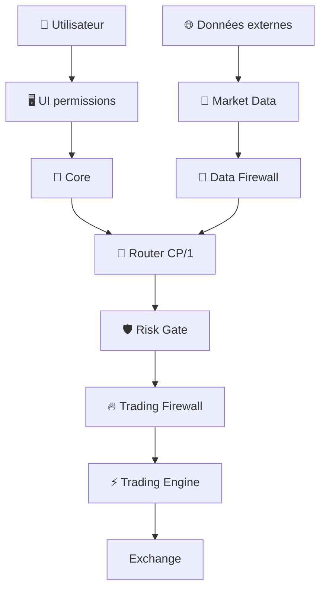

# 🔐 Sécurité IA-TB — V2.0 DEBUG

> **🟢 En simple : IA-TB applique plusieurs barrières indépendantes : coffre de secrets, chiffrement des wallets, Router authentifié, Risk Gate, Firewall, mode Live désactivé par défaut et permissions UI. Une seule barrière ne doit jamais porter toute la sécurité.**

---

## 🧱 Défense en profondeur



---

## 🔑 Coffre des secrets API

**🟢 En simple : les clés API ne sont pas stockées directement en clair dans Settings.**

Le Core génère un coffre RSA :
- RSA 2048 ;
- secrets encryptés RSA-OAEP SHA-256 ;
- private key du coffre protégée par AES-256-GCM ;
- PBKDF2-SHA256 avec itérations ;
- permissions fichier restrictives lorsque supportées.

Le déchiffrement nécessite une session disposant de la clé privée du coffre déverrouillée.

---

## 👛 Secrets Wallet

**🟢 En simple : les clés blockchain utilisent un coffre différent du coffre API.**

Wallet Service chiffre chaque secret de compte en **AES-256-GCM** avec une master key persistante locale.

Les listes de wallets exposent seulement :
- adresse ;
- public key ;
- réseaux ;
- présence du secret.

La clé privée n’est déchiffrée que pour une action ciblée ou une révélation explicite.

---

## 🔀 CP/1

**🟢 En simple : les processus internes doivent prouver qu’ils sont autorisés à utiliser le Router.**

Contrôles :
- token CP ;
- HMAC selon le canal ;
- timestamp ;
- schéma d’action ;
- arguments attendus ;
- taille payload ;
- anti-replay / déduplication selon composants.

---

## 🎟️ Risk Gate

**🟢 En simple : une intention de trade doit obtenir une autorisation Risk temporaire avant d’être considérée exécutable.**

Le `risk_approval_id` est lié à l’intention et peut être consommé lors de la vérification Firewall.

---

## 🔥 Trading Firewall

**🟢 En simple : même une intention Risk valide est encore inspectée avant Trading Engine.**

Le Firewall vérifie :
- auth ;
- signature ;
- timestamp ;
- commande ;
- paire ;
- doublons ;
- approval Risk.

Puis il signe son forward interne vers Trading Engine.

---

## ⚡ Trading Engine SAFE

**🟢 En simple : le lancement standard n’active pas le trading réel.**

`start.command` démarre Trading avec :
```text
IATB_TRADING_LIVE=0
```

Le moteur annonce donc `SAFE` tant que Live n’est pas activé explicitement.

---

## 📡 Data Firewall

**🟢 En simple : la sécurité concerne aussi les données. Une donnée corrompue peut provoquer une mauvaise décision même si les clés sont parfaitement protégées.**

Le Data Firewall vérifie provenance, fraîcheur, type, prix, OHLC, spread et doublons avant publication de données financières validées.

---

## 🖥️ UI

**🟢 En simple : le navigateur ne reçoit pas un accès CP/1 illimité.**

La passerelle UI :
- contrôle les routes ;
- réserve Admin au rôle adapté ;
- proxy les API autorisées ;
- utilise un canal Router READ_ONLY limité.

---

## 📝 Logs

**🟢 En simple : un log peut aider au debug sans afficher un secret.**

Ne jamais écrire dans les logs :
- clé API ;
- private key ;
- seed phrase ;
- password ;
- token de session ;
- secret CP interne.

Les erreurs doivent utiliser des codes ou des états masqués.

---

## ✅ Principe du moindre privilège

**🟢 En simple : chaque composant ne doit recevoir que le droit dont il a besoin.**

- Market Data : lecture publique ;
- Indicator/Fundamental/Liquidity : analyse ;
- Strategy/Supervisor : intention ;
- Risk : analyse + approval ;
- Firewall : validation/forward ;
- Trading : exécution autorisée ;
- Portfolio : mémoire financière ;
- UI : lecture/configuration explicitement permise ;
- Wallet Service : signature blockchain ciblée.
