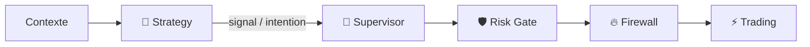

# 🧠 Strategy Engine v2

> **🟢 En simple : Strategy Engine v2 lit un contexte de marché et applique des règles de stratégie pour produire une intention BUY, SELL ou HOLD. Il ne passe jamais l’ordre lui-même.**

Le service est **ACTIVE** dans V2.0 DEBUG, écoute sur **8018** et communique exclusivement en **CP/1** pour le contrôle machine-to-machine.

---

## 🎯 Responsabilité

**🟢 En simple : Strategy répond à “que dit cette stratégie ?”, pas à “envoie l’ordre”.**

Le moteur :
- charge le catalogue des stratégies ;
- sélectionne les stratégies compatibles avec symbole/timeframe ;
- évalue leurs règles ;
- calcule confiance et résultat ;
- agrège plusieurs résultats ;
- peut générer un signal ;
- publie des événements.

Le champ runtime annonce explicitement `execution: INTENTION_ONLY`.

---

## 🔄 Entrées

**🟢 En simple : une stratégie peut combiner plusieurs familles d’information sans aller les récupérer directement sur Internet.**

Le contexte accepte :
- Market ;
- Indicators ;
- Fundamental ;
- Portfolio ;
- timestamp / symbol / timeframe ;
- sélection de stratégies ;
- confiance minimale.

Les dépendances passent par l’architecture Router/CP/1.

---

## 📤 Sorties

**🟢 En simple : la sortie est une recommandation structurée, pas une transaction blockchain ou un ordre exchange.**

Le moteur produit :
- `strategy.evaluation/2.0`
- `strategy.signal/2.0`

Événements :
- `strategy.signal.generated`
- `strategy.evaluation.completed`

Si aucune condition suffisamment forte n’est remplie, le résultat agrégé reste `HOLD`.

---

## 🧪 Dry Run

**🟢 En simple : le mode Dry Run permet de tester une stratégie avec la garantie de ne jamais exécuter.**

La commande `strategy.dry_run` force :
- `dry_run: true`
- `execution: NEVER_EXECUTE`

---

## 🕹️ Commandes CP/1

- `strategy.health`
- `strategy.capabilities`
- `strategy.catalog`
- `strategy.validate`
- `strategy.evaluate`
- `strategy.dry_run`
- `strategy.stats`
- `strategy.state`
- `strategy.reload`
- `strategy.pause`
- `strategy.resume`
- `strategy.reset_stats`

---

## 🖥️ Interface Stratégies

**🟢 En simple : la page Stratégies sert surtout à observer le catalogue, l’état et les résultats du moteur. Elle n’est pas une télécommande d’exécution directe.**

Le canal UI vers le Router est volontairement **READ_ONLY** pour Strategy. Les boutons de la page naviguent entre catalogue, instance active, signaux, backtest/optimisation préparés, risques, historique et logs.

---

## 🔐 Place dans la chaîne de sécurité

**Strategy n’obtient aucune clé API d’exchange pour exécuter un ordre et ne contourne pas Risk/Firewall.**
