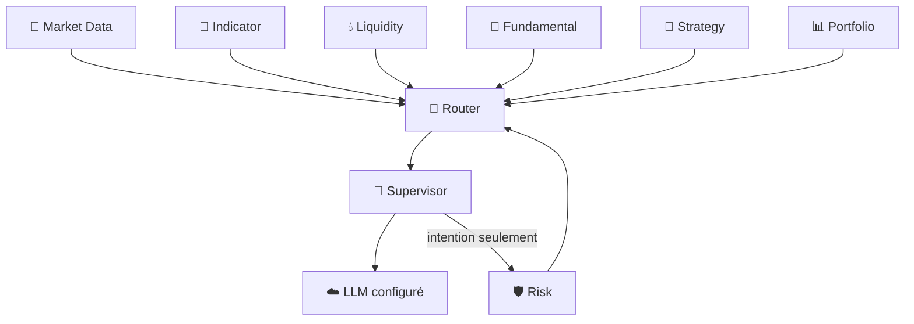

# 🤖 IA Supervisor — V2.0 DEBUG

> **🟢 En simple : le Supervisor est le chef d’orchestre analytique. Il rassemble les informations des Engines, peut demander un raisonnement au LLM et préparer une intention, mais il ne prétend jamais avoir exécuté un trade.**

Le service est **ACTIVE**, écoute sur **3000**, communique en **CP/1** et annonce le rôle `ORCHESTRATOR`.

---

## 🧠 Rôle

**🟢 En simple : au lieu d’envoyer tout le système au LLM, le Supervisor demande à chaque moteur la partie de contexte dont il a besoin, puis assemble une vue cohérente.**

Il peut consommer :
- Market Data ;
- Market Registry ;
- données financières / DeFi ;
- Liquidity ;
- Indicators ;
- Fundamental ;
- Strategy ;
- Risk ;
- Portfolio.

Le Context Orchestrator effectue les requêtes via Router.

---

## 🧩 Contexte

**🟢 En simple : le Supervisor construit un dossier de marché avant de demander une analyse.**

La commande `supervisor.context` accepte notamment :
- symbole ;
- timeframe ;
- source ;
- quantité de données ;
- limite Fundamental ;
- indicateurs demandés ;
- chandeliers d’indicateur ;
- identifiant de corrélation.

Le résultat peut être marqué `degraded` avec des warnings si un sous-système n’est pas disponible.

---

## 💬 LLM

**🟢 En simple : le LLM est une couche de raisonnement configurable, pas le moteur qui possède les clés de trading.**

Le Supervisor utilise un `LLMManager`. Le réglage V2.0 par défaut indique :
- provider : **MOCK** ;
- fallback : **désactivé** ;
- provider OpenAI disponible en configuration ;
- modèle configuré : `gpt-5.6`.

Les commandes utiles :
- `supervisor.llm.health`
- `supervisor.reason`
- `supervisor.analyze`

Le prompt système rappelle que l’exécution appartient à Risk, Firewall et Trading Engine.

---

## 📐 Gestion des indicateurs

**🟢 En simple : le Supervisor peut demander ou créer un indicateur, mais le calcul reste effectué par Indicator Engine.**

Il proxy les opérations suivantes via CP/1 :
- liste d’indicateurs ;
- informations IIL ;
- validation IIL ;
- création d’indicateur ;
- lecture d’une définition ;
- calcul batch.

Ainsi, l’IA ne réimplémente pas elle-même RSI/EMA/etc.

---

## 🛡️ Demande Risk

**🟢 En simple : lorsqu’une intention doit être évaluée pour une éventuelle exécution, le Supervisor peut demander un avis au Risk Gate, mais cette demande ne suffit pas à envoyer l’ordre.**

`supervisor.risk.evaluate` appelle `risk.gate.evaluate` avec une intention.

Si une autorisation est produite, le futur appel Trading doit encore passer :
1. Router ;
2. Trading Firewall ;
3. vérification/consommation du Risk approval ;
4. Trading Engine.

---

## 🚦 Mode d’exécution par défaut

**🟢 En simple : la configuration actuelle est volontairement prudente.**

Réglages observés :
- `ai.orderExecution = PREPARE_ONLY`
- `autonomousTrading.masterEnabled = false`
- `autonomousTrading.mode = OFF`
- confirmation Paper activée ;
- Live Guarded désactivé.

Le service Supervisor lui-même annonce `execution: INTENTION_ONLY`.

---

## 🧱 Flux logique

---

## 📋 Commandes principales

- `supervisor.health`
- `supervisor.capabilities`
- `supervisor.status`
- `supervisor.reload`
- `supervisor.extensions`
- `supervisor.llm.health`
- `supervisor.context`
- `supervisor.analyze`
- `supervisor.reason`
- `supervisor.indicators*`
- `supervisor.risk.evaluate`

---

## 🔐 Limite essentielle

**🟢 En simple : une réponse LLM n’est jamais une preuve qu’un ordre a été exécuté.**

Le Supervisor produit du contexte, du raisonnement et des intentions. La vérité d’une exécution appartient au résultat du Trading Engine, puis à l’événement enregistré dans Portfolio.
