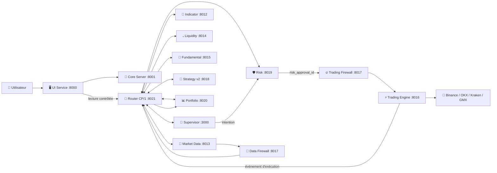

# IA-TB — Wiki · 2.5.2 DEV

> **Consolidation actuelle : `2.5.2` DEV**, depuis `2.5.1` au commit `9027d85c`. [Correctifs et qualification](../Consolidation/2.5.2-DEV.md). Aucune promotion stable ni opération GEN-1.

> **Source nettoyée : [2.4.2-R1 DEV](Nettoyage-2.4.2-R1.md)** sur la branche `2.4.2-R1`, issue de 2.4.1. Recette locale à suivre ; aucune promotion stable ou opération GEN-1.

> **Historique — candidate : [2.4.1 DEV](Correctif-2.4.1.md)** sur `feature/v2.4.1-bank-calendar-cp1`, pour recette locale ; la 2.4.0 et la production restent distinctes.

> **🟢 En simple : IA-TB est une application de trading crypto modulaire. Elle sépare la collecte des données, l’analyse technique, l’analyse fondamentale, les stratégies, le risque, l’exécution des ordres, le portefeuille et la Banque afin qu’un seul module ne puisse pas tout faire sans contrôle.**

> **Historique du développement : 2.4.0 DEV** sur `feature/v2.4-finance-calendar` (PR #21 fusionnée, 566 tests CI rapportés). **Non déployée sur VPS / non promue stable.** Recette locale Auth21/TLS à effectuer.

---

## 🗺️ Vue générale

**🟢 En simple : l’interface parle au Core ou au Router. Le Router distribue ensuite les demandes aux bons moteurs. Les données financières passent par un Firewall de données et les ordres passent par le Risk Gate puis le Trading Firewall avant d’atteindre un exchange.**



> Le **Firewall** utilise le même service sur le port `8017`, avec des workers séparés pour la protection Trading et Market Data.

---

## 🚦 Services principaux

**🟢 En simple : chaque moteur a un rôle précis et tourne comme un service séparé. Cela permet de le diagnostiquer, le redémarrer et le faire évoluer sans transformer toute l’application en un seul bloc.**

| Service | Port | Rôle actuel |
|---|---:|---|
| 🖥️ UI Service | 8000 | pages web et passerelle UI |
| 🧩 Core Server | 8001 | API applicative, Banque, Settings, sécurité, administration |
| 🐙 Kraken Add-On | 8011 | connecteur Kraken historique |
| 📐 Indicator Engine | 8012 | indicateurs techniques et langage IIL |
| 📡 Market Data Collector V2.0 | 8013 | données marché + données financières CeFi/DeFi |
| 💧 Liquidity Engine | 8014 | liquidité, zones, liquidations, contexte financier |
| 🧭 Fundamental Engine V3 | 8015 | news, événements, synthèses, mémoire temporelle |
| ⚡ Trading Engine | 8016 | exécution technique autorisée |
| 🔥 Firewall | 8017 | protection Trading + Market Data |
| 🧠 Strategy Engine v2 | 8018 | évaluation de stratégies, signaux, aucune exécution |
| 🛡️ Risk Engine | 8019 | analyse risque + Risk Gate |
| 📊 Portfolio Engine | 8020 | positions, événements, balances, PnL, historique |
| 🔀 Communication Router | 8021 | routage CP/1 et registre runtime |
| 🤖 IA Supervisor | 3000 | orchestration du contexte et raisonnement IA |

---

## 📚 Lire le Wiki par fonction

### 🏗️ Architecture et communication
- [🚦 État fonctionnel V2.0 DEBUG](Etat-V2.0-DEBUG.md)
- [🏗️ Architecture complète](Architecture.md)
- [🔀 Router Protocol / CP/1](Router-Protocol-CP1.md)
- [🖥️ Interface et pages de l’application](Application-UI.md)

### 📡 Données et analyse
- [📡 Market Data Collector V2.0](Market-Data.md)
- [📐 Indicator Engine](Indicator-Engine.md)
- [💧 Liquidity Engine](Liquidity-Engine.md)
- [🧭 Fundamental Engine V3](Fundamental-Engine.md)
- [📈 Chart Viewer](Chart-Viewer.md)

### 🧠 Décision, risque et exécution
- [🤖 IA Supervisor](Supervisor-IA.md)
- [🧠 Strategy Engine v2](Strategy-Engine.md)
- [🛡️ Risk Engine](Risk-Engine.md)
- [🔥 Firewall](Firewall-Module.md)
- [⚡ Trading Engine](Trading-Engine.md)
- [📊 Portfolio Engine](Portfolio.md)

### 🏦 Banque et sécurité
- [🏦 Banque IA-TB](Bank.md)
- [🔐 Sécurité](Security.md)
- [🔑 Settings / API](Settings-API.md)

### 🛠️ Exploitation
- [🛠️ Administration](Administration.md)
- [📦 Installation](Installation.md)
- [⬆️ Update Manager](Update-Manager.md)
- [🏷️ Versionnage et releases](Versioning-and-Releases.md)
- [🩺 Dépannage](Troubleshooting.md)
- [🗺️ Roadmap](Roadmap.md)
- [🧾 Changelog fonctionnel](Changelog.md)

---

## 🧭 Les pages de l’application

**🟢 En simple : toutes les fonctions importantes sont accessibles depuis une interface web locale, mais les pages n’accèdent pas librement aux moteurs internes. Le service UI applique des routes et des permissions précises.**

| Page | Fonction |
|---|---|
| Trading IA | graphique natif, marché de référence, modules temps réel |
| Chart Viewer | vue graphique indépendante |
| Portfolio | positions, trades, PnL, historique |
| Banque | wallets, clés, transferts, Swap/Bridge, coffres |
| Fondamental | news, événements, sources, synthèses IA |
| Paramètres | IA, API, moteurs, providers, risque, notifications |
| Stratégies | catalogue et état Strategy Engine v2, UI de consultation |
| Statistiques | snapshots financiers CeFi / DeFi |
| Admin | services, logs, Firewall, diagnostics, mises à jour |

---

## 🔐 Règles de sécurité à retenir

**🟢 En simple : une IA, une stratégie ou une page web ne doit jamais pouvoir envoyer directement un ordre à un exchange en contournant les contrôles.**

Le chemin d’exécution protégé est :

```text
Intention
  → Risk Gate
  → risk_approval_id
  → Router / CP/1
  → Trading Firewall
  → Trading Engine
  → Exchange
  → événement Portfolio
```

Les données de marché financières utilisent un autre chemin :

```text
CoinGecko / DeFiLlama / Providers
  → Market Data Collector
  → Data Firewall
  → stockage validé
  → Router / CP/1
  → Engines / UI en lecture
```

---

## ⚠️ État DEBUG

**🟢 En simple : le code possède déjà beaucoup de fonctions réelles, mais “présent dans le code” ne veut pas dire “validé avec de l’argent réel”.**

- le Trading Engine démarre par défaut avec **LIVE désactivé** ;
- le Supervisor est **INTENTION_ONLY** ;
- Strategy Engine v2 est **INTENTION_ONLY** ;
- Fundamental reste **INFORMATION_ONLY** ;
- les transferts BTC/SOL sont soumis au réseau puis doivent encore être suivis jusqu’à confirmation ;
- l’OnChain Reader actuel est surtout EVM ;
- certaines cartes visuelles de Statistiques contiennent encore des valeurs de présentation lorsqu’aucune métrique runtime correspondante n’est disponible.

Le Wiki doit conserver cette distinction entre **fonction intégrée**, **fonction partielle** et **fonction prévue**.
