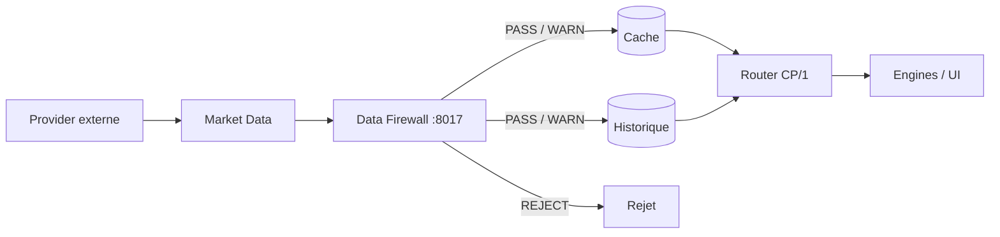

> Version actuelle : **2.2.1 (TEST)**. Voir [la release et les changements](https://github.com/florian74410/IA-Trading-Bot/blob/189e9c09f1549dd8f2f73bb62c62fc19d6f31d15/Documentation/wiki/Release-2.2.1.md). La production GEN-1 reste à déployer et à valider.

# 📡 Market Data Collector V2.1

> **🟢 En simple : Market Data est la porte d’entrée unique des données de marché d’analyse. Il collecte les données externes, les fait contrôler par le Data Firewall avant cache/stockage, puis les distribue par Router/CP1. Les Engines consommateurs n’ont plus besoin de multiplier leurs propres connexions Internet.**

Le service écoute sur **8013** et annonce la version **2.1.0**.

---

## 🧭 Providers et responsabilités

| Provider | Rôle |
|---|---|
| 🐙 Kraken | OHLCV + carnet L2 |
| 🟡 Binance | OHLCV Spot |
| 🟡 Binance Futures | carnet L2 + Open Interest |
| ⚫ OKX | OHLCV |
| 🔵 GMX | prix Oracle / candles |
| 🟣 Hyperliquid | carnet L2 + Open Interest |
| 🦎 CoinGecko | tokens, marché global, exchanges, Market Registry |
| 🦙 DeFiLlama | TVL, DEX, stablecoins, yields, fees |
| ⛓️ On-chain RPC | lecture EVM préparée |

Les providers Candle restent **Kraken / GMX / Binance / OKX**. Hyperliquid et Binance Futures sont utilisés par la famille **Liquidity Microstructure**.

---

## 🧱 Firewall-before-cache

**🟢 En simple : la donnée externe est considérée comme non fiable jusqu’à validation. Le Firewall intervient avant qu’elle soit mise en cache ou enregistrée dans la base.**



Ce modèle est utilisé pour :
- chandeliers ;
- snapshots financiers CoinGecko/DeFiLlama ;
- Market Registry CoinGecko ;
- microstructure de liquidité.

Le Router n’a donc plus besoin de faire un détour HTTP par le Firewall pour `/market-data` : **Market Data garantit lui-même que ce qu’il distribue a été validé à l’ingestion.**

---

## 💧 Microstructure de liquidité

**🟢 En simple : les providers temps réel autrefois présents dans Liquidity Engine sont maintenant hébergés ici.**

Actions CP/1 :
- `marketdata.liquidity.capabilities`
- `marketdata.liquidity.snapshot`
- `marketdata.liquidity.history`
- `marketdata.liquidity.storage`
- `marketdata.liquidity.refresh`

Schéma brut :
`marketdata.liquidity.raw/1.0`

Un snapshot peut contenir :
- carnet bids/asks ;
- source/provider ;
- symbole canonique ;
- profondeur ;
- Open Interest ;
- mark price ;
- liquidations si une source future les fournit ;
- résultat Firewall ;
- état partial/errors.

---

## 💾 Historique Liquidity SQLite

**🟢 En simple : Market Data conserve un historique long terme pour éviter que Liquidity Engine garde des mois de données en RAM.**

Base :
`Shared Data/MarketData/liquidity_history.db`

Rétention :
- minimum : **30 jours** ;
- maximum : **90 jours** ;
- défaut : **90 jours**.

La fréquence de persistance par source/symbole est de **60 secondes** par défaut.

---

## 🦎 CoinGecko vs 🦙 DeFiLlama

**🟢 En simple : CoinGecko et DeFiLlama restent complémentaires et ne doivent pas se battre pour la même métrique.**

- `token_market → COINGECKO`
- `defi_protocol → DEFILLAMA`
- `dex_market → DEFILLAMA`
- `stablecoin_defi → DEFILLAMA`

CoinGecko : market cap, volume global, assets, exchanges, registre.

DeFiLlama : TVL, chains, DEX volume, stablecoins, pools/yields, fees.

---

## 📦 Snapshot financier

**🟢 En simple : CeFi et DeFi restent centralisés dans un snapshot commun validé.**

Schéma :
`iatb.financial.snapshot/2.0`

Stockage financier actuel :
**HYBRID_MEMORY_JSONL**.

Le nouvel historique de microstructure Liquidity utilise pour sa part **SQLite**.

---

## 🧾 Actions principales CP/1

### Marché
- `marketdata.health`
- `marketdata.audit`
- `marketdata.candles`
- `marketdata.providers`

### Liquidité
- `marketdata.liquidity.capabilities`
- `marketdata.liquidity.snapshot`
- `marketdata.liquidity.history`
- `marketdata.liquidity.storage`
- `marketdata.liquidity.refresh`

### Finance
- `marketdata.financial.capabilities`
- `marketdata.financial.snapshot`
- `marketdata.financial.history`
- `marketdata.financial.ai_context`
- `marketdata.financial.storage`

### Registry
- `marketdata.registry.*`

---

## 🤖 Consommateurs

Les données validées peuvent être consommées par :
- Liquidity ;
- Indicator ;
- Strategy ;
- Portfolio ;
- Supervisor ;
- Chat IA en lecture ;
- Statistiques UI.

Les consommateurs analytiques ne doivent pas recréer leurs propres providers Internet lorsque la donnée appartient à Market Data.

---

## ✅ Règles

**🟢 En simple : collecter une fois, vérifier une fois, distribuer proprement.**

1. Le provider reste identifiable.
2. La donnée externe passe le Data Firewall avant stockage.
3. Une donnée manquante reste manquante.
4. Les caches sont bornés.
5. L’historique lourd reste côté Collector.
6. Les Engines utilisent Router/CP1.
7. Les API d’exécution Trading restent séparées du Market Data.


---

## 🧩 Un seul Market Data Collector

**🟢 En simple : il n’existe pas de service “Market Data Liquidity”. Les carnets, dérivés et liquidations sont des familles internes du même Market Data Collector sur le port 8013.**

Organisation canonique :

```text
MarketData/
├── Provider/
│   └── microstructure_provider.js
├── Collectors/
│   ├── microstructure_collector.js
│   └── liquidation_stream_manager.js
├── Workers/
│   ├── binance_liquidations_worker.js
│   └── okx_liquidations_worker.js
├── Storage/
│   └── microstructure_store.js
└── market_data_service.js
```

Le namespace CP/1 canonique est `marketdata.microstructure.*`. Les anciennes commandes `marketdata.liquidity.*` restent temporairement comme alias de compatibilité.

### 📈 Open Interest couvert

**🟢 En simple : IA-TB additionne l’Open Interest réellement observé sur les venues connectées, mais ne l’appelle pas “OI mondial” tant que la couverture n’est pas complète.**

Première couverture :
- Binance Futures — CEX ;
- OKX SWAP — CEX ;
- Hyperliquid Perps — DEX;
- GMX Arbitrum + Avalanche — DEX.

`marketdata.derivatives.open_interest` retourne :
- `cexOpenInterestUsd` ;
- `dexOpenInterestUsd` ;
- `coveredOpenInterestUsd` ;
- détail par venue ;
- venues demandées / reçues / manquantes ;
- label `COVERED_NOT_GLOBAL`.

Les paires stables sont normalisées au niveau analyse : par exemple BTCUSD, BTCUSDT et BTC-USDT-SWAP peuvent contribuer au contexte **BTCUSD**, tout en conservant le symbole de venue.

L’historique est persisté en SQLite 30–90 jours et exposé par `marketdata.derivatives.open_interest.history`. Une paire devient temporairement active lorsqu’elle est demandée ; son OI est ensuite rafraîchi pendant la fenêtre active afin de construire l’historique sans scanner tous les marchés.

### ⚡ Flux de liquidations

**🟢 En simple : les connexions WebSocket appartiennent à Market Data, chacune dans son Worker Thread. Les événements reçus passent ensuite le même Data Firewall que les autres données de marché.**

Workers implémentés dans `debug` :
- Binance Futures : flux public `forceOrder` ;
- OKX : canal public `liquidation-orders`.

Pipeline :

```text
WebSocket Provider
 → Worker Thread Market Data
 → normalisation
 → Data Firewall
 → buffer borné + SQLite
 → CP/1
 → Liquidity Engine / Supervisor
```

Commandes :
- `marketdata.liquidations.recent`
- `marketdata.liquidations.stats`
- `marketdata.liquidations.streams`

Pour OKX, la quantité est conservée en **CONTRACT** et le notionnel USD reste inconnu tant que la valeur de contrat n’a pas été enrichie. Les statistiques exposent donc la couverture du notionnel plutôt que de transformer une valeur inconnue en zéro.

> ⚠️ Les workers et le transport WebSocket sont implémentés sur `debug`, mais leur connexion live doit encore être validée sur le runtime Node 16 du Mac cible avant de marquer la collecte temps réel comme validée en production.
