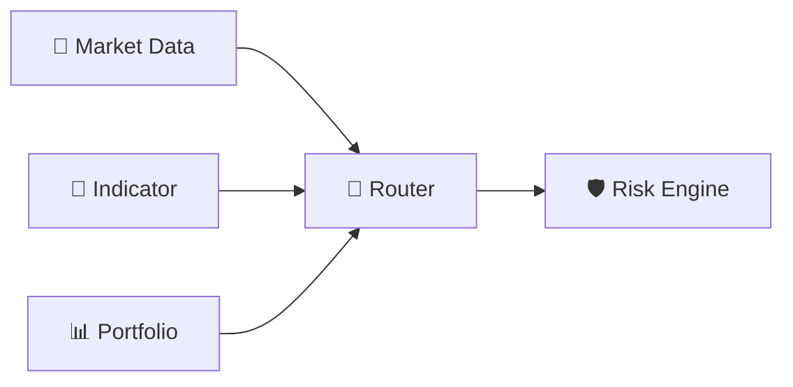
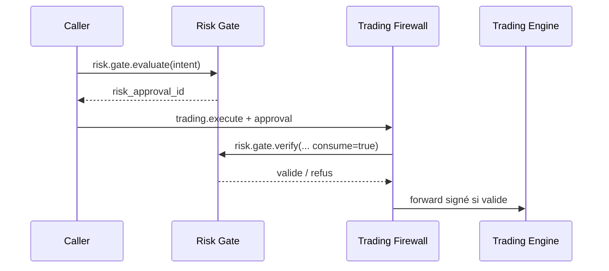

# 🛡️ Risk Engine — R1 / R2 (2.5.0 DEV)

> **🟢 En simple : Risk Engine mesure le danger d’une position ou d’une stratégie. En plus de cette analyse, le Risk Gate peut délivrer une autorisation temporaire appelée `risk_approval_id`. Sans cette autorisation, Trading ne peut pas exécuter une commande sensible.**

Le service écoute sur **8019** et communique via **CP/1**.

> **2.5.0 DEV :** branche `feature/v2.5-risk-management-r1-r2` issue de la source nettoyée 2.4.2-R1. Aucune promotion stable ni mise en production.

---

## Nouveautés Risk Management 2.5

**🟢 En simple :** R1 analyse individuellement les nouveaux ordres ; R2 surveille les positions et publie des alertes sur dépassement. Aucun des deux n'appelle OpenAI ni n'exécute de trade.

- R1.A : valeur notionnelle et exposition au capital ; R1.B : perte théorique au stop et réserve de coûts ; R1.C : plafond de risque selon profil ; R1.D : proposition de quantité arrondie vers le bas.
- R2.1–R2.8 : equity, drawdown, concentration, corrélation (source encore indisponible), marge, stress, risque cumulé au stop, fraîcheur et cohérence des données.
- Paramètres › Risk Manager : bascule générale, profils prudent/équilibré/dynamique, interrupteurs individuels R1/R2, notifications et intervalle de surveillance. **Configuration réservée à ADMIN Auth21.**
- Contrats CP/1 : `risk.r1.evaluate`, `risk.r2.refresh`, `risk.r2.alerts.get`, `supervisor.risk.preview`, `supervisor.risk.alerts`. Les événements R2 ne déclenchent aucun appel au LLM.
- Le Risk Gate n'émet aucun nouvel approval ID sans précontrôle effectué par le service. R1/R2 ne produisent jamais directement d'ordres.

**Limite essentielle :** l'equity du Portfolio Engine correspond aujourd'hui au PnL Trading, pas au capital vérifié. Les modules réclament une valeur `risk_equity_verified` authentique et retournent `INSUFFICIENT_DATA` en son absence. Les nouveaux ordres restent donc bloqués par le Gate quand une mesure indispensable manque ; cette intégration n'est pas qualifiée pour LIVE. Les scénarios sont uniquement indicatifs.

[Spécification technique 2.5](https://github.com/florian74410/IA-Trading-Bot/blob/feature/v2.5-risk-management-r1-r2/Documentation/Risk/R1_R2_2.5_SPEC.md).

---

## 🧮 Analyse du risque

**🟢 En simple : le moteur cherche à quantifier combien une position, une stratégie ou l’ensemble du portefeuille peut exposer l’utilisateur.**

Le Risk Engine peut demander via Router :
- Market Data ;
- Indicator Engine ;
- Portfolio Engine.

Il calcule ou agrège notamment :
- capital à risque ;
- exposition brute ;
- levier ;
- volatilité ;
- drawdown ;
- VaR historique ;
- Expected Shortfall ;
- seuils et alertes configurables.

Les réglages Risk sont persistés dans le store SQLite des paramètres.

---

## 🔀 Aucun accès direct aux autres Engines

**🟢 En simple : Risk n’appelle pas directement Market Data ou Portfolio sur leurs ports ; il utilise le Router comme les autres moteurs.**

Si Indicator ou Portfolio est indisponible, certaines analyses peuvent être marquées **DEGRADED**. Les Market Data nécessaires restent obligatoires pour l’analyse concernée.

---

## 🎟️ Risk Gate

**🟢 En simple : une analyse de risque et une autorisation d’exécution sont deux choses différentes. Le Risk Gate transforme une intention précise en autorisation contrôlée lorsque les règles l’acceptent.**

Commandes :
- `risk.gate.evaluate`
- `risk.gate.verify`

`risk.gate.evaluate` reçoit une intention normalisée comprenant par exemple :
- exchange ;
- marché ;
- symbole ;
- action ;
- side ;
- quantité ;
- prix ;
- stop loss / take profit ;
- levier ;
- reduce only ;
- confiance ;
- metadata.

Si l’intention est acceptée, un `risk_approval_id` est créé avec une durée de vie limitée.

`risk.gate.verify` vérifie que :
- l’approval existe ;
- il correspond à l’intention ;
- il n’est pas expiré ;
- il n’a pas déjà été consommé lorsque la consommation est demandée.

---

## 🔥 Relation avec le Firewall

**🟢 En simple : Risk donne le “visa”, mais le Firewall contrôle encore le passeport, la signature, la paire, les doublons et le trajet.**

Risk ne remplace donc pas le Firewall et ne communique jamais directement avec l’exchange.

---

## 📋 Commandes CP/1

**🟢 En simple : les commandes sont séparées entre analyse, configuration et autorisation.**

- `risk.list_capabilities`
- `risk.position.analyze`
- `risk.portfolio.analyze`
- `risk.strategy.analyze`
- `risk.snapshot`
- `risk.settings.get`
- `risk.settings.set`
- `risk.gate.evaluate`
- `risk.gate.verify`

---

## ⚙️ Réglages par défaut observés

**🟢 En simple : les seuils sont configurables et ne doivent pas être interprétés comme des recommandations financières universelles.**

Le moteur possède notamment des seuils pour :
- capital risk ;
- gross exposure ;
- leverage ;
- volatility ;
- drawdown ;
- VaR.

Ils servent au fonctionnement interne du moteur et peuvent évoluer via Settings.

---

## 🔐 Règle essentielle

**🟢 En simple : un `risk_approval_id` n’est pas un ordre.**

Une exécution réelle nécessite encore :
1. une requête Trading valide ;
2. le passage par le Trading Firewall ;
3. la vérification/consommation du Risk approval ;
4. le forward interne signé ;
5. l’acceptation du Trading Engine ;
6. l’acceptation de l’exchange.
