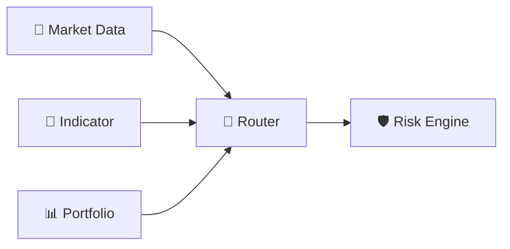
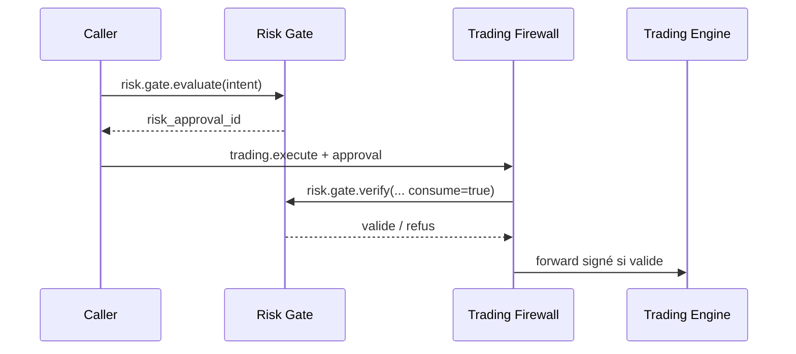

# 🛡️ Risk Engine & Risk Gate — 2.5.0 DEV

> **🟢 En simple : Risk Engine mesure le danger d’une position ou d’une stratégie. En plus de cette analyse, le Risk Gate peut délivrer une autorisation temporaire appelée `risk_approval_id`. Sans cette autorisation, Trading ne peut pas exécuter une commande sensible.**

Le service écoute sur **8019** et communique via **CP/1**.

---

## 🧮 Analyse du risque

**🟢 En simple : le moteur cherche à quantifier combien une position, une stratégie ou l’ensemble du portefeuille peut exposer l’utilisateur.**

Le Risk Engine peut demander via Router :
- Market Data ;
- Indicator Engine ;
- Portfolio Engine.

Il calcule ou agrège notamment :
- capital à risque ;
- exposition brute ;
- levier ;
- volatilité ;
- drawdown ;
- VaR historique ;
- Expected Shortfall ;
- seuils et alertes configurables.

Les réglages Risk sont persistés dans le store SQLite des paramètres.

---

## 🔀 Aucun accès direct aux autres Engines

**🟢 En simple : Risk n’appelle pas directement Market Data ou Portfolio sur leurs ports ; il utilise le Router comme les autres moteurs.**

Si Indicator ou Portfolio est indisponible, certaines analyses peuvent être marquées **DEGRADED**. Les Market Data nécessaires restent obligatoires pour l’analyse concernée.

---

## 🎟️ Risk Gate

**🟢 En simple : une analyse de risque et une autorisation d’exécution sont deux choses différentes. Le Risk Gate transforme une intention précise en autorisation contrôlée lorsque les règles l’acceptent.**

Commandes :
- `risk.gate.evaluate`
- `risk.gate.verify`

`risk.gate.evaluate` reçoit une intention normalisée comprenant par exemple :
- exchange ;
- marché ;
- symbole ;
- action ;
- side ;
- quantité ;
- prix ;
- stop loss / take profit ;
- levier ;
- reduce only ;
- confiance ;
- metadata.

Si l’intention est acceptée, un `risk_approval_id` est créé avec une durée de vie limitée.

`risk.gate.verify` vérifie que :
- l’approval existe ;
- il correspond à l’intention ;
- il n’est pas expiré ;
- il n’a pas déjà été consommé lorsque la consommation est demandée.

---

## 🔥 Relation avec le Firewall

**🟢 En simple : Risk donne le “visa”, mais le Firewall contrôle encore le passeport, la signature, la paire, les doublons et le trajet.**

Risk ne remplace donc pas le Firewall et ne communique jamais directement avec l’exchange.

---

## 📋 Commandes CP/1

**🟢 En simple : les commandes sont séparées entre analyse, configuration et autorisation.**

- `risk.list_capabilities`
- `risk.position.analyze`
- `risk.portfolio.analyze`
- `risk.strategy.analyze`
- `risk.snapshot`
- `risk.settings.get`
- `risk.settings.set`
- `risk.gate.evaluate`
- `risk.gate.verify`

---

## ⚙️ Réglages par défaut observés

**🟢 En simple : les seuils sont configurables et ne doivent pas être interprétés comme des recommandations financières universelles.**

Le moteur possède notamment des seuils pour :
- capital risk ;
- gross exposure ;
- leverage ;
- volatility ;
- drawdown ;
- VaR.

Ils servent au fonctionnement interne du moteur et peuvent évoluer via Settings.

---

## 🔐 Règle essentielle

**🟢 En simple : un `risk_approval_id` n’est pas un ordre.**

Une exécution réelle nécessite encore :
1. une requête Trading valide ;
2. le passage par le Trading Firewall ;
3. la vérification/consommation du Risk approval ;
4. le forward interne signé ;
5. l’acceptation du Trading Engine ;
6. l’acceptation de l’exchange.

---

## 🧩 R1 et R2 — chantier 2.5 DEV

> **🟢 En simple :** R1 calcule le risque d'un nouvel ordre. R2 surveille les positions et signale les dépassements. Ces calculs sont locaux, sans requête OpenAI.

**R1** se compose de quatre modules activables : capital/notionnel (A), perte au stop et frais/slippage (B), budget de risque (C) et proposition d'une quantité réduite (D). Les résultats CP/1 contiennent une synthèse numérique brève pour le Supervisor. Une proposition de nouvelle quantité n'est jamais une autorisation.

**R2** comprend huit modules : equity, drawdown, concentration, corrélation, marge/liquidation, stress, risque au stop global et intégrité des données. La corrélation et les stress tests restent **non disponibles** sans données et méthodes validées ; leurs cases sont désactivées dans la nouvelle UI. R2 n'exécute ni vente ni liquidation automatique.

**Paramètres → Risk Engine** contient l'activation générale, les interrupteurs individuels R1/R2 et le profil de risque. L'enregistrement utilise une route réservée ADMIN Auth21, et non un contournement de la passerelle CP/1 UI.

**Limite actuelle :** le Portfolio `TRADING_ONLY` ne donne pas un capital total fiable et le monitoring automatique global est interdit en mode Auth21 tant qu'une collecte propriétaire n'est pas disponible. Les nouveaux modules ne remplacent pas encore le Risk Gate obligatoire sur chaque intention du Supervisor. Les protections d'exécution existantes restent intactes.

Voir [spécification technique v2.5](https://github.com/florian74410/IA-Trading-Bot/blob/2.5/Documentation/RISK_ENGINE_R1_R2_V2_5.md).
