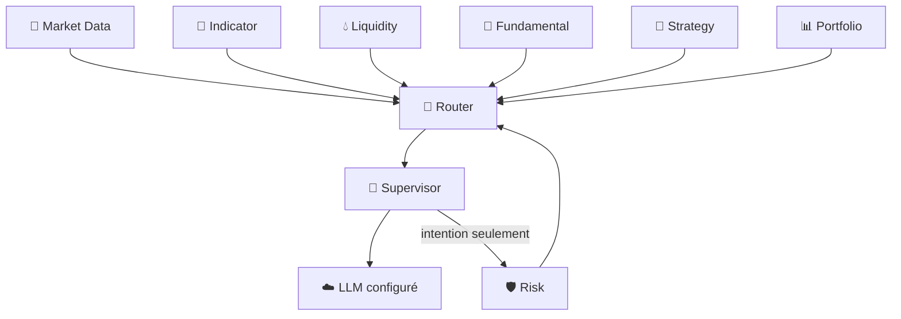

# 🤖 IA Supervisor — V2.0 DEBUG

> **🟢 En simple : le Supervisor est le chef d’orchestre analytique. Il rassemble les informations des Engines, peut demander un raisonnement au LLM et préparer une intention, mais il ne prétend jamais avoir exécuté un trade.**

Le service est **ACTIVE**, écoute sur **3000**, communique en **CP/1** et annonce le rôle `ORCHESTRATOR`.

---

## 🧠 Rôle

**🟢 En simple : au lieu d’envoyer tout le système au LLM, le Supervisor demande à chaque moteur la partie de contexte dont il a besoin, puis assemble une vue cohérente.**

Il peut consommer :
- Market Data ;
- Market Registry ;
- données financières / DeFi ;
- Liquidity ;
- Indicators ;
- Fundamental ;
- Strategy ;
- Risk ;
- Portfolio.

Le Context Orchestrator effectue les requêtes via Router.

---

## 🧩 Contexte

**🟢 En simple : le Supervisor construit un dossier de marché avant de demander une analyse.**

La commande `supervisor.context` accepte notamment :
- symbole ;
- timeframe ;
- source ;
- quantité de données ;
- limite Fundamental ;
- indicateurs demandés ;
- chandeliers d’indicateur ;
- identifiant de corrélation.

Le résultat peut être marqué `degraded` avec des warnings si un sous-système n’est pas disponible.

---

## 💬 LLM

**🟢 En simple : le LLM est une couche de raisonnement configurable, pas le moteur qui possède les clés de trading.**

Le Supervisor utilise un `LLMManager`. Le réglage V2.0 par défaut indique :
- provider : **MOCK** ;
- fallback : **désactivé** ;
- provider OpenAI disponible en configuration ;
- modèle configuré : `gpt-5.6`.

Les commandes utiles :
- `supervisor.llm.health`
- `supervisor.reason`
- `supervisor.analyze`

Le prompt système rappelle que l’exécution appartient à Risk, Firewall et Trading Engine.

---

## 📐 Gestion des indicateurs

**🟢 En simple : le Supervisor peut demander ou créer un indicateur, mais le calcul reste effectué par Indicator Engine.**

Il proxy les opérations suivantes via CP/1 :
- liste d’indicateurs ;
- informations IIL ;
- validation IIL ;
- création d’indicateur ;
- lecture d’une définition ;
- calcul batch.

Ainsi, l’IA ne réimplémente pas elle-même RSI/EMA/etc.

---

## 🛡️ Demande Risk

**🟢 En simple : lorsqu’une intention doit être évaluée pour une éventuelle exécution, le Supervisor peut demander un avis au Risk Gate, mais cette demande ne suffit pas à envoyer l’ordre.**

`supervisor.risk.evaluate` appelle `risk.gate.evaluate` avec une intention.

Si une autorisation est produite, le futur appel Trading doit encore passer :
1. Router ;
2. Trading Firewall ;
3. vérification/consommation du Risk approval ;
4. Trading Engine.

---

## 🚦 Mode d’exécution par défaut

**🟢 En simple : la configuration actuelle est volontairement prudente.**

Réglages observés :
- `ai.orderExecution = PREPARE_ONLY`
- `autonomousTrading.masterEnabled = false`
- `autonomousTrading.mode = OFF`
- confirmation Paper activée ;
- Live Guarded désactivé.

Le service Supervisor lui-même annonce `execution: INTENTION_ONLY`.

---

## 🧱 Flux logique



---

## 📋 Commandes principales

- `supervisor.health`
- `supervisor.capabilities`
- `supervisor.status`
- `supervisor.reload`
- `supervisor.extensions`
- `supervisor.llm.health`
- `supervisor.context`
- `supervisor.analyze`
- `supervisor.reason`
- `supervisor.indicators*`
- `supervisor.risk.evaluate`

---

## 🔐 Limite essentielle

**🟢 En simple : une réponse LLM n’est jamais une preuve qu’un ordre a été exécuté.**

Le Supervisor produit du contexte, du raisonnement et des intentions. La vérité d’une exécution appartient au résultat du Trading Engine, puis à l’événement enregistré dans Portfolio.

---

## 🧠 Cognitive Runtime V1 — 2.6 DEBUG (nouveau, expérimental)

Le service réel `App/Supervisor/supervisor_service.js` propose maintenant une première voie **memory-first** distincte de `supervisor.reason` (compatibilité conservée).

### Pipeline

1. **BOOTLOADER / SOUL** — règles compactes versionnées : `App/Supervisor/Soul/identity.md`.
2. **RAM** — petit état de l'objectif en cours, non persistant, plafonné à 64 sessions.
3. **Mémoire courte** — `App/Supervisor/Memory/short-term.js` : SQLite, 40 messages maximum, TTL de 24 h, persistante entre redémarrages.
4. **Mémoire personnelle/longue** — `App/Supervisor/Memory/personal-memory.js` : résumé personnel, faits vérifiés, et propositions séparées `PENDING`. Rien n'est promu automatiquement.
5. **Registres** — inventaire local CP/1 via `protocol_registry_v2`; lecture facultative et **read-only** du Function Registry SQLite via `IATB_FUNCTION_REGISTRY_DB`. La liste des commandes autorisées n'est *pas* une permission d'exécuter.
6. **Consultation ciblée** — au plus deux recherches en seconde étape : `memory.search`, `registry.commands.list`, `registry.permissions.list`, `cp1.registry.list`. Aucun ordre Trading, déploiement ou redémarrage n'est déclenché par ces outils.
7. **LLM** — le `LLMManager` existant appelle le fournisseur configuré ; en mode `OPENAI_API`, les requêtes empruntent le service sécurisé **AI Gateway → Responses API**, non un nouveau client direct. Les résultats sont normalisés en message, observations et suggestions mémoire.

Le modèle reçoit au plus 8 anciens messages tronqués, un résumé personnel de 1 200 caractères et les seules observations recherchées. Les données mémoire et CP/1 sont traitées comme **non fiables** (pas comme des instructions).

### Nouvelles commandes CP/1

| Commande | Arguments | Rôle |
| --- | --- | --- |
| `supervisor.cognitive.reason` | `prompt` (requis), `sessionId` (optionnel), `model` (optionnel) | Réponse structurée, historique persistant et propositions mémoire **PENDING** |
| `supervisor.cognitive.status` | aucun | État du runtime et des connexions |
| `supervisor.llm.models` | aucun | Fournisseur, modèle sélectionné, liste autorisée |

Les contrats figurent dans `App/Core/Communication/ProtocolRegistry/supervisor.json` **et** `App/Supervisor/FunctionRegistry/Functions.json`. Le Router valide les actions enregistrées ; le protocole CP/1 reste authentifié et aucun droit d'exécution financière n'est ajouté.

### Choisir son LLM

Dans les Settings de l'application : `ai.llm.provider = OPENAI_API` et `ai.llm.openai.model = gpt-5.6` (ou un modèle accessible à votre compte). Par défaut, les installations DEBUG peuvent rester sur `MOCK`. `ai.llm.fallbackEnabled` reste au choix de l'administrateur.

L'environnement `IATB_OPENAI_ALLOWED_MODELS` accepte une liste séparée par virgules, par exemple :

```bash
export IATB_OPENAI_ALLOWED_MODELS='gpt-5.6,gpt-5-mini,gpt-4.1-mini'
```

La commande `supervisor.llm.models` révèle les modèles autorisés. Une requête `supervisor.cognitive.reason` peut choisir `model` dans cette liste. L'autorisation et la disponibilité effective du modèle côté OpenAI sont validées par le Gateway et l'API au moment de l'appel. Aucune clé API n'est transmise via CP/1 à la conversation.

### Limitations V1 / sécurité

- **Pas de confirmation d'appel API réel en CI** : les tests utilisent `MOCK` ; un compte OpenAI configuré et une vérification manuelle DEBUG sont nécessaires.
- **Pas d'analyse automatique des logs** pour l'instant : aucune commande CP/1 de recherche de logs n'a été ajoutée sans handler vérifié. Les analyses de santé et les actions administratives font partie de la prochaine étape.
- **Pas de mémoire multiutilisateur exposée** : les sessions cognitives appartiennent au périmètre interne du Supervisor et du Router de confiance. Le service CP/1 utilise une authentification de service ; un rattachement à une identité utilisateur vérifiée sera nécessaire avant d'exposer l'historique dans une UI publique.
- La mémoire longue ne stocke automatiquement que des **propositions en attente** ; leur vérification/promotion exige un processus ADMIN de confiance encore à construire.
- En l'absence de `IATB_FUNCTION_REGISTRY_DB`, la lecture du registre de permissions apparaît `connected:false` (aucune base vide créée).
- La RELEASE GEN-1 et l'exécution Trading LIVE ne sont pas modifiées.

### Validation

```bash
cd App
npm ci
node --test tests/supervisor-short-term-memory.test.js tests/supervisor-cognitive-runtime.test.js
```

Workflow GitHub Actions : `.github/workflows/cp1-registry-integration.yml`. Les résultats CI doivent être consultés avant tout déploiement.
