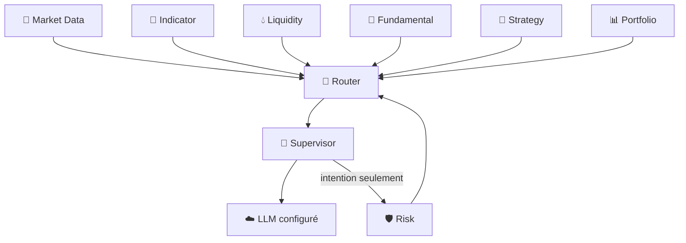

# 🤖 IA Supervisor — V2.0 DEBUG

> **🟢 En simple : le Supervisor est le chef d’orchestre analytique. Il rassemble les informations des Engines, peut demander un raisonnement au LLM et préparer une intention, mais il ne prétend jamais avoir exécuté un trade.**

Le service est **ACTIVE**, écoute sur **3000**, communique en **CP/1** et annonce le rôle `ORCHESTRATOR`.

---

## 🧠 Rôle

**🟢 En simple : au lieu d’envoyer tout le système au LLM, le Supervisor demande à chaque moteur la partie de contexte dont il a besoin, puis assemble une vue cohérente.**

Il peut consommer :
- Market Data ;
- Market Registry ;
- données financières / DeFi ;
- Liquidity ;
- Indicators ;
- Fundamental ;
- Strategy ;
- Risk ;
- Portfolio.

Le Context Orchestrator effectue les requêtes via Router.

---

## 🧩 Contexte

**🟢 En simple : le Supervisor construit un dossier de marché avant de demander une analyse.**

La commande `supervisor.context` accepte notamment :
- symbole ;
- timeframe ;
- source ;
- quantité de données ;
- limite Fundamental ;
- indicateurs demandés ;
- chandeliers d’indicateur ;
- identifiant de corrélation.

Le résultat peut être marqué `degraded` avec des warnings si un sous-système n’est pas disponible.

---

## 💬 LLM

**🟢 En simple : le LLM est une couche de raisonnement configurable, pas le moteur qui possède les clés de trading.**

Le Supervisor utilise un `LLMManager`. Le réglage V2.0 par défaut indique :
- provider : **MOCK** ;
- fallback : **désactivé** ;
- provider OpenAI disponible en configuration ;
- modèle configuré : `gpt-5.6`.

Les commandes utiles :
- `supervisor.llm.health`
- `supervisor.reason`
- `supervisor.analyze`

Le prompt système rappelle que l’exécution appartient à Risk, Firewall et Trading Engine.

---

## 📐 Gestion des indicateurs

**🟢 En simple : le Supervisor peut demander ou créer un indicateur, mais le calcul reste effectué par Indicator Engine.**

Il proxy les opérations suivantes via CP/1 :
- liste d’indicateurs ;
- informations IIL ;
- validation IIL ;
- création d’indicateur ;
- lecture d’une définition ;
- calcul batch.

Ainsi, l’IA ne réimplémente pas elle-même RSI/EMA/etc.

---

## 🛡️ Demande Risk

**🟢 En simple : lorsqu’une intention doit être évaluée pour une éventuelle exécution, le Supervisor peut demander un avis au Risk Gate, mais cette demande ne suffit pas à envoyer l’ordre.**

`supervisor.risk.evaluate` appelle `risk.gate.evaluate` avec une intention.

Si une autorisation est produite, le futur appel Trading doit encore passer :
1. Router ;
2. Trading Firewall ;
3. vérification/consommation du Risk approval ;
4. Trading Engine.

---

## 🚦 Mode d’exécution par défaut

**🟢 En simple : la configuration actuelle est volontairement prudente.**

Réglages observés :
- `ai.orderExecution = PREPARE_ONLY`
- `autonomousTrading.masterEnabled = false`
- `autonomousTrading.mode = OFF`
- confirmation Paper activée ;
- Live Guarded désactivé.

Le service Supervisor lui-même annonce `execution: INTENTION_ONLY`.

---

## 🧱 Flux logique



---

## 📋 Commandes principales

- `supervisor.health`
- `supervisor.capabilities`
- `supervisor.status`
- `supervisor.reload`
- `supervisor.extensions`
- `supervisor.llm.health`
- `supervisor.context`
- `supervisor.analyze`
- `supervisor.reason`
- `supervisor.indicators*`
- `supervisor.risk.evaluate`

---

## 🔐 Limite essentielle

**🟢 En simple : une réponse LLM n’est jamais une preuve qu’un ordre a été exécuté.**

Le Supervisor produit du contexte, du raisonnement et des intentions. La vérité d’une exécution appartient au résultat du Trading Engine, puis à l’événement enregistré dans Portfolio.

---

## 🧠 Cognitive Runtime V1 — historique (remplacé par V1.1)

Le service réel `App/Supervisor/supervisor_service.js` propose maintenant une première voie **memory-first** distincte de `supervisor.reason` (compatibilité conservée).

### Pipeline

1. **BOOTLOADER / SOUL** — règles compactes versionnées : `App/Supervisor/Soul/identity.md`.
2. **RAM** — petit état de l'objectif en cours, non persistant, plafonné à 64 sessions.
3. **Mémoire courte** — `App/Supervisor/Memory/short-term.js` : SQLite, 40 messages maximum, TTL de 24 h, persistante entre redémarrages.
4. **Mémoire personnelle/longue** — `App/Supervisor/Memory/personal-memory.js` : résumé personnel, faits vérifiés, et propositions séparées `PENDING`. Rien n'est promu automatiquement.
5. **Registres** — inventaire local CP/1 via `protocol_registry_v2`; lecture facultative et **read-only** du Function Registry SQLite via `IATB_FUNCTION_REGISTRY_DB`. La liste des commandes autorisées n'est *pas* une permission d'exécuter.
6. **Consultation ciblée** — au plus deux recherches en seconde étape : `memory.search`, `registry.commands.list`, `registry.permissions.list`, `cp1.registry.list`. Aucun ordre Trading, déploiement ou redémarrage n'est déclenché par ces outils.
7. **LLM** — le `LLMManager` existant appelle le fournisseur configuré ; en mode `OPENAI_API`, les requêtes empruntent le service sécurisé **AI Gateway → Responses API**, non un nouveau client direct. Les résultats sont normalisés en message, observations et suggestions mémoire.

Le modèle reçoit au plus 8 anciens messages tronqués, un résumé personnel de 1 200 caractères et les seules observations recherchées. Les données mémoire et CP/1 sont traitées comme **non fiables** (pas comme des instructions).

### Nouvelles commandes CP/1

| Commande | Arguments | Rôle |
| --- | --- | --- |
| `supervisor.cognitive.reason` | `prompt` (requis), `sessionId`, `model` | **OWNER Auth21 uniquement depuis la V1.1**, via `supervisor.user.request` ; mémoire et propositions **PENDING** |
| `supervisor.cognitive.status` | aucun | État du runtime et des connexions |
| `supervisor.llm.models` | aucun | Fournisseur, modèle sélectionné, liste autorisée |

Les contrats figurent dans `App/Core/Communication/ProtocolRegistry/supervisor.json` **et** `App/Supervisor/FunctionRegistry/Functions.json`. Le Router valide seulement les commandes de transport `CP1`; les opérations `OWNER` exigent la preuve Auth21 via `supervisor.user.request`. Aucun droit financier n'est ajouté.

### Choisir son LLM

Dans les Settings de l'application : `ai.llm.provider = OPENAI_API` et `ai.llm.openai.model = gpt-5.6` (ou un modèle accessible à votre compte). Par défaut, les installations DEBUG peuvent rester sur `MOCK`. `ai.llm.fallbackEnabled` reste au choix de l'administrateur.

L'environnement `IATB_OPENAI_ALLOWED_MODELS` accepte une liste séparée par virgules, par exemple :

```bash
export IATB_OPENAI_ALLOWED_MODELS='gpt-5.6,gpt-5-mini,gpt-4.1-mini'
```

La commande `supervisor.llm.models` révèle les modèles autorisés. Une requête `supervisor.cognitive.reason` peut choisir `model` dans cette liste. L'autorisation et la disponibilité effective du modèle côté OpenAI sont validées par le Gateway et l'API au moment de l'appel. Aucune clé API n'est transmise via CP/1 à la conversation.

### Limitations V1 / sécurité

- **Pas de confirmation d'appel API réel en CI** : les tests utilisent `MOCK` ; un compte OpenAI configuré et une vérification manuelle DEBUG sont nécessaires.
- **Pas d'analyse automatique des logs** pour l'instant : aucune commande CP/1 de recherche de logs n'a été ajoutée sans handler vérifié. Les analyses de santé et les actions administratives font partie de la prochaine étape.
- **Mise à jour V1.1 :** les mémoires sont maintenant isolées par identité Auth21 vérifiée. L'accès conversationnel public reste à intégrer à une interface utilisateur dédiée ; aucun historique n'est exposé en lecture CP/1 directe.
- La mémoire longue ne stocke automatiquement que des **propositions en attente** ; leur vérification/promotion exige un processus ADMIN de confiance encore à construire.
- En l'absence de `IATB_FUNCTION_REGISTRY_DB`, la lecture du registre de permissions apparaît `connected:false` (aucune base vide créée).
- La RELEASE GEN-1 et l'exécution Trading LIVE ne sont pas modifiées.

### Validation

```bash
cd App
npm ci
node --test tests/supervisor-short-term-memory.test.js tests/supervisor-cognitive-runtime.test.js
```

Workflow GitHub Actions : `.github/workflows/cp1-registry-integration.yml`. Les résultats CI doivent être consultés avant tout déploiement.

---

## 🛡️ Cognitive Runtime V1.1 — Auth21, configuration et qualification

**La V1.1 remplace la consultation cognitive directe de la V1 par un accès propriétaire Auth21.** Le nom `supervisor.cognitive.reason` représente désormais une opération **OWNER**, non une commande exécutable directement dans le Router. Pour dialoguer, l'interface authentifiée envoie `supervisor.cognitive.reason` au **Core UserManagement CP Bridge** ; Core valide la session, émet une preuve signée pour `supervisor.user.request`, puis le Supervisor revalide la preuve et fait confirmer la session par Core avant de charger la mémoire. Les privilèges génériques du Function Registry marquent `supervisor.cognitive.reason` comme `hard_deny`. Le statut et le catalogue des modèles restent disponibles en lecture CP/1.

### Identité et confidentialité
- Les sessions d'un utilisateur sont isolées sous un identifiant dérivé du `clientId` **vérifié par Auth21**, jamais du champ d'identité fourni dans le prompt.
- Les messages persistants, la RAM et les recherches de souvenirs sont isolés par utilisateur/session ; le Soul reste une politique commune du moteur.
- Les mots de passe, clés `sk-` et Bearer sont masqués **par règles heuristiques** avant envoi au LLM ou écriture conversationnelle. Cela n'est **pas** une prévention exhaustive des fuites de données : ne jamais placer de secrets dans les prompts.
- Fichiers SQLite et dossiers cognitifs : accès propriétaire seulement (`0600` / `0700`). Les sessions expirent après 24 h ; 40 messages au maximum sont conservés par session. Les propositions non examinées peuvent être purgées après 30 jours.

### Budget et résilience
- Les messages anciens sont écartés du contexte envoyé à l'API pour conserver un budget estimé de **4 400 tokens en entrée** et **1 800 tokens maximum en sortie**. Le calcul `octets UTF-8 / 3` est un **estimateur approximatif**, pas un tokenizer exact ; les limites du fournisseur restent déterminantes.
- Une réponse JSON incorrecte provoque **une seule tentative corrective**. Les réponses incomplètes ou de refus échouent explicitement, sans exécuter d'outil.
- Le message utilisateur est enregistré avant l'appel API ; un échec est mémorisé sous forme d'erreur contrôlée afin de conserver la continuité après redémarrage.
- Les outils sont en lecture seule et plafonnés à deux recherches; la découverte CP/1 utilise le vrai endpoint machine authentifié `GET /communication/v1/registry`.
- Sauvegarde SQLite en ligne possible via le `CognitiveRuntime.backup()` interne du Supervisor. Les copies sont placées dans `<IATB_RUNTIME_ROOT>/cognitive/backups` et privées; ne pas exposer cette méthode directement à un LLM ni à CP/1. La restauration doit être faite hors ligne après arrêt des services.

### Choix persistant du modèle

Le Core expose l'opération owner `supervisor.llm.select` **uniquement pour ADMIN** : `{ "provider": "OPENAI_API", "model": "gpt-5-mini" }` (ou `MOCK` pour DEBUG). La sélection est sauvegardée dans le profil `app_profile` du Settings Store SQLite existant et recharge le fournisseur Supervisor.

Les commandes `supervisor.llm.models` et `supervisor.cognitive.status` affichent les modèles autorisés et l'état des mémoires, du Soul, des registres, du Router et du Gateway. Elles ne retournent aucune conversation ni clé API. Les modèles OpenAI réellement accessibles dépendent des droits du compte et du Gateway.

Le chemin réseau pour les utilisateurs Auth21 est :

```text
Client Auth21 -> Core CP Bridge -> preuve owner -> Router CP/1
             -> supervisor.user.request -> Cognitive Runtime
             -> LLMManager -> Core AI Gateway (délégation vérifiée) -> OpenAI
```

Le Gateway Core n'accepte le payload cognitif que si le modèle est dans la liste autorisée, que le prompt courant correspond au prompt signé initialement, que les tailles et les tokens sont bornés, et que la session est toujours valide. Aucun outil ou ordre financier ne peut être demandé via ce canal.

### Tests
- `App/tests/supervisor-owner-cognitive-auth.test.js` — politique Core Auth21, délégation OpenAI, sélection persistante en Settings.
- `App/tests/supervisor-cognitive-runtime.test.js` — sécurité, isolation, erreurs LLM, sauvegarde, persistance.
- `App/tests/supervisor-cognitive-network-smoke.js` — vrais processus **Router et Supervisor** en DEBUG, revalidation TLS Core simulée et `MOCK`, puis redémarrage Supervisor.
- Workflow : `.github/workflows/cp1-registry-integration.yml` ; le changement de frontière Auth21 est également soumis aux autres workflows Core.

**Limites :** le test de réseau n'est pas un déploiement sur VPS, le Core Auth21 TLS est simulé, et aucun appel réseau à l'API OpenAI réel n'est inclus. Les analyses de logs en continu et les autorisations de trading restent hors périmètre V1.1.
