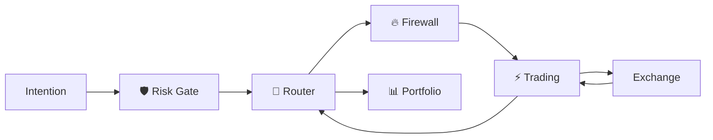

# ⚡ Trading Engine — V2.0 DEBUG

> **🟢 En simple : Trading Engine est le seul moteur chargé de transformer une commande autorisée en requête technique vers un exchange. Il ne choisit pas la stratégie et refuse les ordres qui n’ont pas passé Risk + Firewall.**

Le service écoute sur **8016**. Le mode Live est **désactivé par défaut**.

---

## 🎯 Responsabilité

**🟢 En simple : Trading sait “comment exécuter”, pas “quoi trader”.**

Il prend en charge :
- validation des paramètres d’exécution ;
- sélection de l’adapter Exchange ;
- exécution / annulation / fermeture ;
- normalisation du résultat ;
- historique local ;
- émission d’un événement vers Portfolio.

---

## 🏦 Exchanges enregistrés

**🟢 En simple : le moteur possède des adapters pour les quatre familles actuellement exposées dans l’interface Trading IA.**

- Binance ;
- OKX ;
- Kraken ;
- GMX.

Les capacités précises dépendent de l’adapter et du type de marché.

---

## 🔐 Conditions d’une mutation

**🟢 En simple : connaître le port 8016 et le protocole CP/1 ne suffit pas pour exécuter un ordre.**

Pour `trading.execute`, `trading.cancel` ou `trading.close_position` :
1. la requête doit contenir un `risk_approval_id` ;
2. elle doit passer par le Trading Firewall ;
3. le Firewall doit vérifier/consommer l’approval ;
4. le Firewall signe son forward interne ;
5. Trading Engine vérifie cette signature.

Sans forward valide : `FIREWALL_FORWARD_REQUIRED`.

---

## 🚦 SAFE / LIVE

**🟢 En simple : le runtime démarre en mode sécurisé, sans trading réel activé automatiquement.**

Le manifest Process Registry définit :
```text
IATB_TRADING_LIVE=0
```

Le health du moteur expose :
- `liveExecutionEnabled`
- `mode: SAFE | LIVE`
- `riskApprovalRequired`
- `firewallForwardRequired`
- `portfolioFeed`

L’activation Live doit rester une décision explicite et contrôlée.

---

## 📦 Commandes CP/1

**🟢 En simple : seules quelques opérations de trading sont exposées.**

- `trading.health`
- `trading.capabilities`
- `trading.execute`
- `trading.cancel`
- `trading.close_position`
- `trading.history`

Les opérations mutantes ont un schéma d’arguments strict.

---

## 📊 Retour vers Portfolio

**🟢 En simple : après une tentative d’exécution, Trading transforme le résultat en événement financier standard pour que Portfolio puisse garder la mémoire.**

Types d’événements normalisés possibles :
- `ORDER_ACCEPTED`
- `ORDER_FILLED`
- `ORDER_CANCELLED`
- `POSITION_CLOSED`
- `EXECUTION_REJECTED`

L’événement contient notamment :
- exchange ;
- symbole ;
- side ;
- quantité ;
- filled quantity ;
- prix moyen ;
- frais ;
- exchange order id ;
- `risk_approval_id` ;
- statut.

Trading l’envoie à `portfolio.event.record` via Router.

---

## 🔄 Resynchronisation

**🟢 En simple : si Portfolio rate un événement au moment où il se produit, il peut relire l’historique Trading.**

`trading.history` est READ_ONLY et peut être filtré par :
- date ;
- exchange ;
- symbole ;
- limite.

Portfolio l’utilise pour la reprise/synchronisation.

---

## 🧱 Flux complet



---

## ⚠️ Métadonnée à réaligner

**🟢 En simple : le vrai port Trading est 8016.**

Une entrée de `ProtocolRegistry/trading.json` contient encore `8017`, qui est le port du Firewall. Le Process Registry et le service Trading utilisent **8016** ; cette valeur est retenue par le Wiki comme vérité runtime.


---

## 🧾 Trading Logs V2 — intégration 2.4.0 DEV

> **🟢 En simple :** l'historique reste lisible dans son ancien format JSONL ; une base SQLite WAL en conserve une copie récupérable et exploitable plus tard, sans ouvrir un nouvel accès aux utilisateurs.

Sur `feature/v2.4-finance-calendar`, la PR #21 intègre le miroir `trading_logs.db` en parallèle de `trading_history.jsonl` (toujours **autoritaire**). Les nouvelles écritures sont expurgées et réconciliables ; un échec SQLite ne supprime pas le JSONL. Rejeu idempotent, limite 64 Mio, séparation des espaces utilisateurs et respect des snapshots en lecture seule. Un état de dégradation est disponible dans `health.executionLogs`.

**Sécurité :** protections ADMIN Auth21 et Risk/Firewall inchangées, aucune route SQLite globale ajoutée, pas de trading réel activé. Les journaux historiques ne sont pas réécrits automatiquement ; les valeurs sensibles cachées dans du texte libre ne peuvent être garanties comme masquées.

**Validation :** 566 tests CI rapportés pour la PR #21 ; recette locale sur Macro et toute validation LIVE encore à effectuer. Voir [documentation technique](https://github.com/florian74410/IA-Trading-Bot/blob/feature/v2.4-finance-calendar/Documentation/TRADING_LOGS_V2_INTEGRATION_2.4.md).
