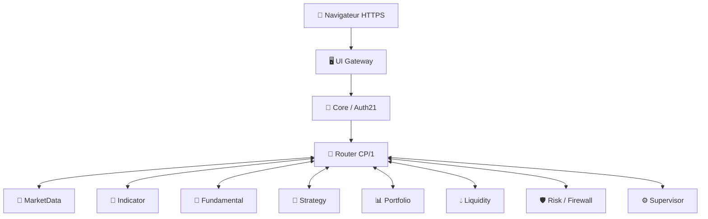

# 🏗️ Architecture IA-TB 2.2.0 : comment les moteurs coopèrent

> **En simple :** l'application est composée de **13 services Docker** dans la stack de recette, chacun avec une responsabilité. Le navigateur ne commande pas directement les moteurs internes : il passe par une **passerelle**, puis par **Core**, qui vérifie son identité et ses droits.

[🏠 Sommaire](Home.md) · [🔐 Auth21](V2.2-Comptes-et-roles.md) · [🧪 Recette](V2.2-Recette-et-limites.md)

## 🌐 Schéma simplifié

Ce schéma représente les **responsabilités et échanges logiques**, pas chaque liaison réseau réelle. Une opération métier autorisée peut demander une **capacité signée** : preuve limitée à une action, à ses arguments, à un propriétaire et à une session encore valable.

## 🧩 Qui fait quoi ?

| Service | Sa mission, sans jargon | Terme technique utile |
|---|---|---|
| **UI / Gateway** | Sert les pages et reçoit les requêtes du navigateur | Gateway = passerelle |
| **Core** | Gère les comptes, sessions, règles et fonctions centrales | Auth21 / RBAC |
| **Router** | Transmet une demande au bon moteur | CP/1 = protocole interne |
| **MarketData** | Collecte et normalise les données de marché | Provider / OHLCV |
| **Indicator** | Calcule les indicateurs à partir de données disponibles | Indicateur / compilation |
| **Fundamental** | Traite informations et événements | Analyse fondamentale |
| **Strategy** | Conserve et exploite les stratégies autorisées | Stratégie |
| **Portfolio** | Suit portefeuille et historique associé | Position / événement |
| **Liquidity** | Étudie la liquidité et le contexte de marché | Liquidité |
| **Risk** | Applique les contrôles de risque | Risk Gate |
| **Firewall** | Contrôle le passage des flux et actions sensibles | Filtrage |
| **Supervisor** | Coordonne et surveille des opérations | Supervision |
| **SSH UI Bridge** | Donne accès à l'interface via un socket privé et un tunnel SSH | Socket Unix / tunnel |

Le **Trading Engine**, chargé de l'exécution, **n'est pas lancé dans la stack de recette 13 services**. L'exécution d'ordres et les transferts signés restent interdits dans cette release authentifiée.

## 📈 Exemple : consulter un graphique

1. L'utilisateur choisit un marché et une paire dans l'interface.
2. La demande suit le parcours autorisé via Gateway/Core.
3. MarketData fournit les données disponibles pour ce marché.
4. ChartViewer les affiche ; Indicator peut calculer un indicateur si l'accès est autorisé.
5. L'interface affiche les résultats ou une indisponibilité explicite.

**OHLCV** signifie *Open, High, Low, Close, Volume* : ouverture, plus haut, plus bas, clôture et volume des bougies. Le fait qu'un fournisseur soit configuré ne garantit pas qu'il répond ni que toutes ses paires sont disponibles.

## 🛡️ Pourquoi plusieurs barrières ?

Auth21 vérifie **qui demande quoi** ; Router et les Engines vérifient **quelles opérations sont permises** ; Risk et Firewall portent d'autres contrôles métier. Un bouton visible n'est donc pas une autorisation. À l'inverse, une requête HTTP 403 peut être un refus de sécurité prévu, pas une panne.

## 📖 Lexique

- **Docker** : exécution de services en conteneurs isolés.
- **Engine** : service applicatif spécialisé.
- **API** : interface par laquelle deux logiciels communiquent.
- **CP/1** : protocole de communication interne utilisé par IA-TB.
- **HMAC / capacité signée** : preuve cryptographique permettant de contrôler l'origine et le contenu d'une opération.
- **Provider** : fournisseur de données ou de services externes.
- **Socket Unix** : point de communication local sans port Internet public.

À lire également : [Architecture historique](Architecture.md), [Market Data](Market-Data.md), [Chart Viewer](Chart-Viewer.md), [Indicator Engine](Indicator-Engine.md).
