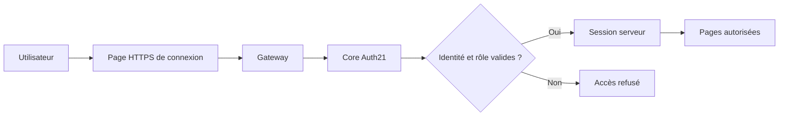

# 🔐 Auth21 et User Management V1 — IA-TB 2.2.0

> **En simple :** chaque utilisateur se connecte avec un e-mail et un mot de passe. Le serveur sait **qui** effectue une opération, **à quelles données** il a droit et **si son rôle** l'autorise. La gestion des autres comptes reste réservée à la CLI administrative.

[🏠 Sommaire](Home.md) · [🚀 Démarrer](V2.2-Guide-de-demarrage.md) · [🏗️ Architecture](V2.2-Architecture-et-moteurs.md)

## 👤 Les trois rôles

| Rôle | Explication | Attention |
|---|---|---|
| **ADMIN** | Compte habilité à administrer les utilisateurs via la CLI et à exécuter des fonctions techniques autorisées | ADMIN n'obtient pas d'accès automatique aux données privées d'autrui ni aux opérations financières interdites |
| **USER** | Compte standard avec accès aux fonctionnalités métier autorisées et à ses propres données | Il ne gère pas les autres comptes |
| **GUEST** | Accès aux métadonnées et lectures publiques explicitement permises | Pas d'écriture métier ni de déclenchement de calcul payant |

**RBAC** signifie *contrôle d'accès fondé sur les rôles*. Les permissions sont vérifiées **sur le serveur**, pas seulement parce qu'un bouton est visible ou caché. Une fonction inconnue est refusée par défaut (*fail closed*).

## 🔑 Comment fonctionne la connexion ?



- Mot de passe : les nouveaux hashes utilisent **Argon2id**, algorithme conçu pour ralentir les attaques par essais de mots de passe. Les anciens hashes PBKDF2 restent pris en charge pour la transition prévue.
- **Cookie HttpOnly/Secure/SameSite=Strict** : le navigateur transporte un cookie de session protégé. Le jeton brut n'est pas conservé dans la base SQLite.
- **CSRF** : protection contre des actions déclenchées par un site tiers à l'insu de l'utilisateur.
- **Révocation** : l'administrateur peut invalider des sessions, notamment après suspension, changement de rôle ou reset du mot de passe.
- Sessions : la documentation v2.2.0 spécifie une durée absolue d'une heure et jusqu'à 20 sessions actives par compte ; vérifier le comportement réel pendant la recette.

## 🗂️ Isolation des données

Le **clientId** est un identifiant propriétaire établi par Core à partir de la session authentifiée : le navigateur ne peut pas imposer celui d'une autre personne. Les préférences, profils, sessions, indicateurs Custom, stratégies, portefeuilles et autres ressources migrées doivent suivre ce propriétaire.

**Exemple :** Alice crée un indicateur Custom. Bob ne doit ni le voir ni le calculer. Ce type d'isolation a été exercé en tests automatisés ; la vérification de l'ensemble des parcours sur GEN-1 reste à faire.

Les données créées avant Auth21 ne sont **pas automatiquement attribuées** au premier ADMIN. Leur transfert demande un inventaire et un import explicite, hors ligne, avec sauvegarde et contrôle du propriétaire.

## 🖥️ Administration des comptes : CLI uniquement

Dans IA-TB v2.2.0, l'outil natif est `node App/CLI/users.js` (chemin exact à adapter au déploiement). Commandes documentées :

```text
list
show CL000001
create
set-role CL000002 USER
disable CL000002
enable CL000002
reset-password CL000002
revoke-sessions CL000002
audit
```

Ces opérations exigent un **terminal réel**, l'utilisateur système non-root propriétaire des données et une authentification ADMIN. Aucune API HTTP d'administration des autres utilisateurs n'est prévue.

**IA-TB-CLI v1.4** est un projet compagnon séparé destiné à rendre ces opérations plus pratiques depuis XFCE. Ne pas confondre les commandes *prévues* du compagnon avec celles déjà disponibles dans le programme natif v2.2.0.

## 🔁 Ancien SuperAdmin → ADMIN

Lors de la migration documentée, le rôle historique `SUPERADMIN` est **converti en `ADMIN`**, tout en conservant l'identifiant interne, l'empreinte du mot de passe et les données chiffrées. **Ce n'est pas la création automatique d'un compte supplémentaire.**

Avant de désactiver un éventuel ancien compte distinct : vérifier sur une **copie de recette** l'identité cible, la connexion par **e-mail**, le nouveau rôle, les données associées et le maintien d'au moins un ADMIN actif. Aucun effacement automatique n'est prévu. Un nom d'affichage `Admin` n'est pas nécessairement un identifiant de connexion : le login web v2.2.0 utilise l'e-mail.

## 📖 Lexique

**Argon2id** : algorithme de hachage de mot de passe. **SQLite** : base de données locale. **Audit** : journal des opérations et événements de sécurité, sans mots de passe. **Ownership** : contrôle de la propriété d'une donnée. **Migration** : adaptation contrôlée d'une base existante vers un nouveau schéma.

Référence détaillée : [User Management V1](../USER_MANAGEMENT_V1.md).
