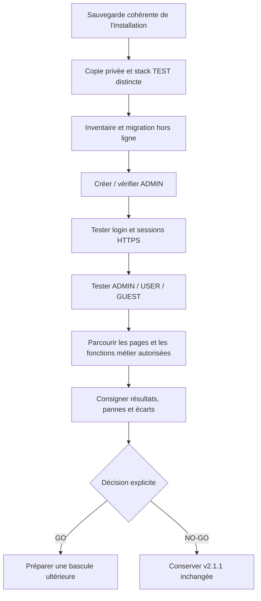

# 🧪 IA-TB v2.2.0 — Recette GEN-1, limites et versions

> **Attention : v2.2.0 est une préversion TEST publiée pour les essais.** La publication de l'archive et la réussite des tests GitHub **ne prouvent pas** que l'installation de production GEN-1 a été migrée ou validée.

[🏠 Sommaire](Home.md) · [🚀 Guide](V2.2-Guide-de-demarrage.md) · [🔐 Comptes](V2.2-Comptes-et-roles.md)

## 🏷️ Trois états à ne pas confondre

| État | Ce que cela signifie |
|---|---|
| **Code publié** | Une version et ses archives sont disponibles sur GitHub |
| **Recette réussie** | Les fonctionnalités retenues sont vérifiées sur une installation représentative |
| **Production validée** | L'opérateur autorise une bascule contrôlée, surveillée et réversible |

**v2.1.1** : dernière version stable GEN-1 connue avant recette. **v2.2.0** : livraison Auth21/User Management destinée à la recette, pas une promotion automatique de production.

## ✅ Ce que les tests de publication ont validé

La publication officielle fait état de **519 tests réussis**, zéro échec et zéro ignoré, et d'une stack Docker de **13 services** contrôlée avant et après redémarrage. Les preuves de version et leurs empreintes SHA-256 sont livrées avec la release. Les tests emploient des comptes, données et transports externes fictifs ; ils ne valent pas exécution financière réelle.

Consulter la [release v2.2.0](https://github.com/florian74410/IA-Trading-Bot/releases/tag/v2.2.0).

## ⛔ Fonctions indisponibles ou non qualifiées

- **Trading LIVE** : exécution d'ordres, transferts et swaps signés indisponibles en mode authentifié.
- **REMOTE_LLM** : non qualifié ; ne pas le présenter comme actif.
- **E-mail sortant** : envoi de mails non qualifié ; pas de récupération automatique par e-mail.
- **Snapshots à chaud** : sauvegarde coordonnée pendant les écritures non qualifiée. Utiliser une sauvegarde cohérente *hors ligne* pour les migrations.
- **Couverture intégrale des pages et données historiques** : vérification GEN-1 encore nécessaire, avec attribution explicite des données historiques à un propriétaire.

La route `/auth21/capabilities` permet d'obtenir l'état des fonctionnalités autorisées dans le contexte authentifié, après connexion.

## 🔬 Parcours de recette recommandé

**Important :** ne jamais brancher directement la stack TEST sur les volumes actifs v2.1.1, ni lancer la migration via l'updater HTTP. Garder les clés d'origine, fichiers WAL nécessaires, configurations, données et manifestes. Le rollback s'effectue depuis une **copie cohérente**, tous les writers arrêtés.

La [procédure officielle GEN-1 v2.2.0](../GEN1_TEST_2.2.0.md) est la référence pour les prérequis techniques et commandes. Elle doit être vérifiée sur l'environnement réel avant exécution.

## 👀 Feuille de vérification pour un novice

- [ ] Je suis bien sur la version **TEST** et non sur la production v2.1.1.
- [ ] La page de connexion s'ouvre en **HTTPS**.
- [ ] Le compte ADMIN se connecte, affiche son Profil et peut se déconnecter.
- [ ] Un USER ne voit pas les données privées d'un autre USER.
- [ ] Un GUEST ne peut pas modifier les données métier.
- [ ] Les marchés, graphiques, indicateurs, stratégies et pages autorisées chargent correctement.
- [ ] Les refus d'accès sont compréhensibles et justifiés.
- [ ] Aucun trade LIVE n'est tenté.
- [ ] Je peux arrêter la stack TEST sans toucher à la production.

## 📖 Lexique

**Release** : livraison versionnée. **SHA-256** : empreinte de fichier permettant de vérifier son intégrité. **WAL** : journal SQLite associé aux transactions. **Snapshot** : capture cohérente d'un état pour sauvegarde. **Rollback** : retour contrôlé vers une version précédente. **GO/NO-GO** : autorisation ou refus de promouvoir une version.

Références : [Notes v2.2.0](../RELEASE_2.2.0.md) · [Procédure GEN-1](../GEN1_TEST_2.2.0.md) · [Gestion utilisateurs](../USER_MANAGEMENT_V1.md).
