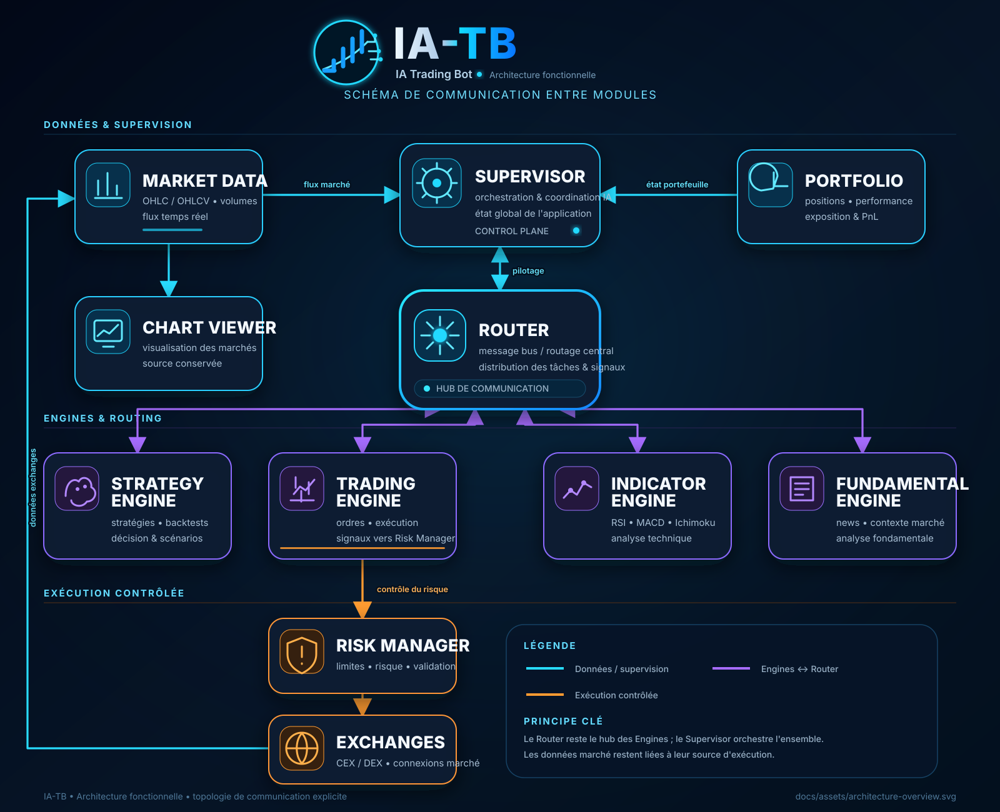

# IA-Trading-Bot (IA-TB)

Application modulaire de trading crypto : CEX/DEX, Market Data, Chart Viewer, Indicator Engine, Strategy Engine, Fundamental Engine, gestion centralisée des API et Update Manager versionné.

  

## Architecture générale

Le système repose sur un **Router central** qui orchestre les différents moteurs spécialisés :

- `Supervisor <-> Router`
- `Strategy Engine <-> Router`
- `Trading Engine <-> Router`
- `Indicator Engine <-> Router`
- `Fundamental Engine <-> Router`
- `Market Data -> Supervisor`
- `Exchanges -> Market Data`
- `Trading Engine -> Risk Manager -> Exchanges`
- `Market Data -> Chart Viewer`
- `Portfolio -> Supervisor`

# 🗺️ Roadmap

La roadmap ci-dessous reflète l'état réel de développement. Le détail complet est maintenu dans [`docs/wiki/Roadmap.md`](docs/wiki/Roadmap.md).

### Légende

- [ ] À faire
- ◐ En cours / codé mais pas encore validé
- [x] Terminé dans le code
- ⚠️ À vérifier sur le runtime cible
- ★ Validé STABLE

## Version v1.7.9

**État : ◐ DÉVELOPPEMENT / DEBUG**

### Interface & Administration

- [x] Refonte de la page Admin Backend Manager.
- [x] Correction du test `Flux & collecte` : résultat dans le header Flux.
- [x] Journalisation des tests de Flux conservée.
- [x] Asset officiel du nouvel écran d'authentification dans `Docs/Assets/IA-TB_Auth_v1.7.9.png`.
- [ ] Intégrer le nouvel écran/logo dans la page d'authentification réelle.
- ⚠️ Tester Admin + Fundamental + Auth sur Firefox / macOS High Sierra.

### UserData / SQLite

- [x] UserData Server local `127.0.0.1:8020`.
- [x] Une DB SQLite par utilisateur dans `User Data/<username>/user_data.db`.
- [x] DB hors Git et protégée par UpdateManager.
- [x] Client/cache mémoire UserData.
- [x] API compte, Settings, credentials et stratégies.
- [x] Vault AES-256-GCM et clés hors dépôt.
- [x] Migration/projection depuis les anciens fichiers `.dat`.
- ◐ SQLite comme source canonique des Settings : couche prête, projections `.dat` encore utilisées par le serveur principal.
- ◐ SQLite comme source canonique du Login : compte SQLite supporté, `user.dat` encore projeté pour compatibilité.
- [ ] Supprimer progressivement la dépendance runtime aux anciens fichiers Settings/Login.
- ⚠️ Tester `better-sqlite3@8.7.0` sous Node 16.20.2 / High Sierra.
- ⚠️ Tester restauration de la DB après changement de build.

### Compte / Authentification

Nouvelle règle : le **Username est créé à l'inscription, lié au compte/email et immuable**.

- [x] Validation backend du Username.
- [x] Support du compte dans UserData Server / client.
- [x] Migration d'un ancien compte vers UserData.
- [ ] Ajouter le champ Username à la première inscription.
- [ ] Enregistrer Username + Email + hash directement dans SQLite à l'inscription.
- [ ] Afficher le Username en lecture seule dans Settings.
- [ ] Faire utiliser SQLite directement par `/api/setup`, `/api/login`, changement d'email et changement de mot de passe.
- ⚠️ Tester création de compte, reconnexion et modifications de compte.

### Settings

- [x] API générique `scope/key/value` SQLite.
- [x] Import initial des paramètres existants vers UserData.
- ◐ Synchronisation SQLite ↔ projections `.dat` disponible.
- [ ] Migrer `/api/settings/general` vers SQLite direct.
- [ ] Migrer langue, puissance IA, modulation/mosaïque et profil actif vers SQLite direct.
- [ ] Confirmer qu'un patch v1.7.8 → v1.7.9 ne remplace jamais les Settings utilisateur.

### Secrets / API

- [x] Infrastructure Vault SQLite.
- [x] Credentials chiffrés dans UserData.
- ◐ Compatibilité `secrets_v2.dat` encore présente.
- [ ] Faire lire directement les credentials UserData/Vault par OpenAI/X/exchanges.
- [ ] Préparer la sauvegarde/restauration sécurisée de la clé maître.

### Connecteurs & Market Data

- [x] Hyperliquid Provider `SOCKET` dans MarketData.
- [x] WebSocket générique + OHLCV Hyperliquid.
- ⚠️ Test live Hyperliquid sur le Mac cible.
- [ ] CoinGecko après consolidation UserData.
- [ ] Coinbase plus tard.
- [ ] OKX plus tard.

### Finalisation v1.7.9

- [ ] Revue complète du patch.
- [ ] Tests Mac High Sierra : démarrage, Login, Settings, UserData, Fundamental, Admin, MarketData.
- [ ] Test d'update v1.7.8 → v1.7.9 sans perte de données.
- [ ] Corrections de régression.
- [ ] CHANGELOG + Wiki.
- [ ] Patch officiel v1.7.8 → v1.7.9.
- [ ] Build complet v1.7.9.
- [ ] Archive officielle + SHA-256.
- [ ] Promotion `debug` → `main` après validation.
- [ ] ★ v1.7.9 STABLE.

## Version v1.8

**État : 🔒 EN ATTENTE DE CLÔTURE DE v1.7.9**

La v1.8 ne démarre qu'après validation ★ STABLE de v1.7.9.

---

## Rôle du dépôt

Ce dépôt est la **source de vérité du code source courant de IA-TB**.

- `main` = code source complet de la dernière version validée.
- `Updates/Patches/` = archives de mise à jour installables entre deux versions.
- L'historique Git conserve les anciennes versions du code ; il n'est pas nécessaire de dupliquer le projet dans des dossiers `v1.x`.
- Chaque nouvelle mise à jour repart de la dernière source validée présente sur GitHub, puis remplace/actualise cette source une fois les tests terminés.
- Les secrets, coffres, clés privées, tokens, logs, bases locales et données utilisateur ne doivent jamais être commités.

## Documentation

La documentation officielle est versionnée dans [`docs/wiki`](docs/wiki/Home.md).

- [Accueil documentation](docs/wiki/Home.md)
- [Installation](docs/wiki/Installation.md)
- [Architecture](docs/wiki/Architecture.md)
- [Connecteurs CEX / DEX](docs/wiki/Connectors-CEX-DEX.md)
- [Market Data](docs/wiki/Market-Data.md)
- [Chart Viewer](docs/wiki/Chart-Viewer.md)
- [Indicator Engine](docs/wiki/Indicator-Engine.md)
- [Settings / API](docs/wiki/Settings-API.md)
- [Update Manager](docs/wiki/Update-Manager.md)
- [Sécurité](docs/wiki/Security.md)
- [Roadmap](docs/wiki/Roadmap.md)

## Versionnage

La branche de développement utilise les versions `v1.x`. Chaque changement publié incrémente la version. Le passage à `v2.x` correspondra à la phase suivant le développement/test.

Cycle officiel :

`Source GitHub N -> Développement N+1 -> Tests -> Patch -> CHANGELOG -> Commit source N+1 -> Updates/Patches -> Wiki`

Voir [Versionnage et releases](docs/wiki/Versioning-and-Releases.md) et le [protocole de mise à jour](docs/RELEASE_PROTOCOL.md).
