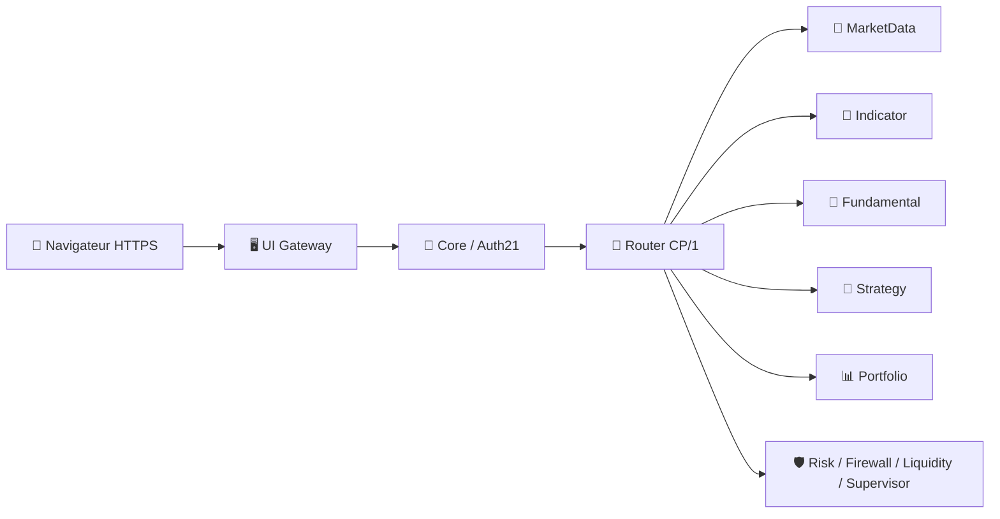

# 🤖 IA-Trading-Bot
### Plateforme modulaire d'analyse des marchés crypto et de trading assisté par IA

**Dernière version publiée : `v2.2.0` · 🧪 TEST / Recette GEN-1**

[🚀 Découvrir l'application](#-découvrir-ia-tb) · [✨ Nouveautés v2.2](#-nouveautés-de-la-version-220) · [🏗️ Architecture](#️-une-architecture-à-moteurs) · [📖 Wiki](Documentation/wiki/Home.md) · [📦 Release](https://github.com/florian74410/IA-Trading-Bot/releases/tag/v2.2.0)

---

> [!IMPORTANT]
> **v2.2.0 est une version publiée pour tests, pas une production officiellement validée.** La dernière installation GEN-1 stable connue reste **v2.1.1**, tant que la recette de v2.2.0 et sa promotion ne sont pas approuvées. Aucun ordre financier réel n'est disponible en mode authentifié.

## 🌍 Découvrir IA-TB

**En bref :** IA-TB centralise des données de marchés crypto, des graphiques, des indicateurs et des modules d'analyse dans une interface web. Chaque **Engine** (moteur logiciel spécialisé) réalise une tâche particulière : collecter, calculer, analyser, surveiller ou stocker des informations.

*Illustration architecturale du projet — le fonctionnement effectif et les disponibilités sont décrits ci-dessous.*

| 📈 Marchés & graphiques | 🧮 Indicateurs & stratégies | 📰 Informations & analyse |
|---|---|---|
| Données multi-fournisseurs, bougies **OHLCV**, ChartViewer et outils de dessin | Indicator Engine, indicateurs personnalisés et stratégies associées aux utilisateurs | Fundamental Engine, actualités et modules d'analyse |
| 🔐 **Comptes & sécurité** | 💼 **Portefeuille & suivi** | 🛠️ **Modules indépendants** |
| Connexion, rôles, sessions et données privées par utilisateur | Espaces Portfolio et historiques autorisés, sans exécution financière dans cette préversion | Services Docker, Router CP/1, Firewall, supervision et diagnostics |

> **OHLCV** = *Open, High, Low, Close, Volume* : ouverture, plus haut, plus bas, clôture et volume d'une bougie. **CEX/DEX** = plateforme centralisée / décentralisée d'échange d'actifs. Les connecteurs et fonctions dépendent du fournisseur et des autorisations disponibles.

## ✨ Nouveautés de la version 2.2.0

La v2.2.0 introduit **Auth21 / User Management V1** sur la base graphique v2.1.1.

| Nouveauté | Ce que cela change pour vous |
|---|---|
| 🔑 **Connexion e-mail + mot de passe** | Chaque personne dispose de son propre compte. |
| 👥 **Rôles ADMIN, USER, GUEST** | Les opérations sont limitées suivant les droits du compte (**RBAC**). |
| 🪪 **Profil et sessions** | Consultation du profil, changement de mot de passe, révocation de sessions et déconnexion. |
| 🧩 **Espaces privés** | Les ressources migrées sont isolées par **clientId** (identifiant du propriétaire), contrôlé par le serveur. |
| 🖥️ **Administration CLI** | Les comptes sont créés et administrés en terminal, sans tableau de bord public d'administration. |
| 🛡️ **Contrôles interservices** | Une opération métier autorisée doit être contrôlée par Core et les services concernés. |
| 📦 **Recette Docker** | 13 services testés avant/après redémarrage, avec des données de validation fictives. |

**Validation publiée :** 519 tests réussis, aucun échec ni test ignoré, selon la publication v2.2.0. Ces tests ne remplacent pas une recette fonctionnelle sur GEN-1.

[📋 Notes complètes](Documentation/RELEASE_2.2.0.md) · [🔐 Comprendre Auth21](Documentation/wiki/V2.2-Comptes-et-roles.md) · [🧪 Essais GEN-1](Documentation/GEN1_TEST_2.2.0.md)

## 🏗️ Une architecture à moteurs

Le schéma est une **vue logique simplifiée** : il n'énumère pas toutes les connexions internes. **CP/1** désigne le protocole de communication entre services. **Gateway** désigne la passerelle qui reçoit les requêtes du navigateur. **Auth21** contrôle l'identité, la session et les permissions. Les moteurs d'exécution d'ordres ne sont pas démarrés dans la stack de recette de 13 services.

[🔍 Découvrir les 13 services](Documentation/wiki/V2.2-Architecture-et-moteurs.md)

## 🔐 Qui peut faire quoi ?

| | ADMIN | USER | GUEST |
|---|:---:|:---:|:---:|
| Se connecter et consulter son profil | ✅ | ✅ | ✅ |
| Utiliser ses fonctions privées autorisées | ✅ | ✅ | — |
| Consulter les métadonnées publiques permises | ✅ | ✅ | ✅ |
| Administrer les comptes par CLI | ✅ | — | — |
| Exécuter des ordres ou transferts financiers en v2.2.0 authentifiée | ❌ | ❌ | ❌ |

**RBAC** signifie *Role-Based Access Control* : les permissions sont vérifiées côté serveur, et non simplement en masquant des boutons. **ADMIN** n'implique ni accès arbitraire aux données privées d'autrui ni privilège root.

[📖 Guide complet des comptes et privilèges](Documentation/wiki/V2.2-Comptes-et-roles.md)

## ⚠️ Limites actuelles de v2.2.0 TEST

| Disponible pour la recette | Non disponible ou non qualifié |
|---|---|
| Authentification, Profil, sessions, RBAC et CLI des comptes | **Trading LIVE**, ordres, transferts et swaps signés |
| Données utilisateur et fonctions métier migrées | **REMOTE_LLM** |
| Analyse, graphique, indicateurs et fonctions autorisées à vérifier | Envoi d'e-mails et récupération du compte par e-mail |
| Tests Docker isolés et fichiers de qualification | Snapshots coordonnés **à chaud** |
| Imports historiques avec propriétaire explicite | Adoption automatique d'anciens wallets et données globales |

> [!WARNING]
> Une version publiée n'est **pas** une autorisation de migration. Les données historiques demandent un inventaire et une attribution contrôlée. **Ne jamais remplacer directement les volumes v2.1.1 par une stack v2.2.0** ni utiliser l'updater HTTP pour cette migration.

## 🚦 Installer ou tester ?

**Vous découvrez le projet ?** Commencez par le [guide de démarrage illustré](Documentation/wiki/V2.2-Guide-de-demarrage.md) puis l'[architecture](Documentation/wiki/V2.2-Architecture-et-moteurs.md).

**Vous préparez GEN-1 ?** Suivez la [procédure officielle de recette v2.2.0](Documentation/GEN1_TEST_2.2.0.md) sur une **copie privée isolée**, avec sauvegarde complète, clé d'origine, HTTPS et retour arrière prévu. La recette n'est pas un déploiement automatique.

**Vous cherchez les archives ?** Consultez la [release v2.2.0 et ses preuves SHA-256](https://github.com/florian74410/IA-Trading-Bot/releases/tag/v2.2.0). **SHA-256** est une empreinte servant à vérifier qu'un fichier est intact.

## 📚 Documentation & ressources

| Pour qui ? | Ressource |
|---|---|
| 👋 Nouveau lecteur | [Accueil du Wiki](Documentation/wiki/Home.md) |
| 👤 Utilisateur | [Premiers pas en v2.2](Documentation/wiki/V2.2-Guide-de-demarrage.md) |
| 🔐 Administrateur | [Comptes et rôles](Documentation/wiki/V2.2-Comptes-et-roles.md) · [User Management technique](Documentation/USER_MANAGEMENT_V1.md) |
| 🧑‍💻 Développeur | [Architecture des Engines](Documentation/wiki/V2.2-Architecture-et-moteurs.md) · [Documentation technique historique](Documentation/wiki/Architecture.md) |
| 🧪 Testeur | [Recette et limites](Documentation/wiki/V2.2-Recette-et-limites.md) · [Procédure GEN-1](Documentation/GEN1_TEST_2.2.0.md) |
| 🗺️ Suivi du projet | [ROADMAP détaillée](ROADMAP.md) · [Historique des changements](CHANGELOG.md) |

### 🕰️ Versions et statut

| Référence | Statut | Utilité |
|---|---|---|
| **v2.2.0** | 🧪 **TEST — dernière publiée** | Auth21, User Management V1, qualification Docker et recette GEN-1 |
| **v2.1.1** | 🔒 **Dernière stable GEN-1 connue** | Référence de production et de retour arrière |
| **v2.0 / v1.x** | 📜 Historique | Anciennes architectures et étapes de développement, consultables dans Git et la roadmap |

**Règle de maintenance du README :** ce fichier présente toujours **la dernière version publiée** et son **statut réel (TEST ou STABLE)**. Les checklists et récits des versions antérieures restent dans [ROADMAP.md](ROADMAP.md), [CHANGELOG.md](CHANGELOG.md), le [Wiki](Documentation/wiki/Home.md) et les [releases](https://github.com/florian74410/IA-Trading-Bot/releases) — ils ne sont plus recopiés sur la page d'accueil.

---

**IA-TB · Une architecture modulaire, des permissions explicites et des versions vérifiables.**

[⬆️ Retour en haut](#-ia-trading-bot) · [📖 Wiki](Documentation/wiki/Home.md) · [📦 Release 2.2.0](https://github.com/florian74410/IA-Trading-Bot/releases/tag/v2.2.0)

