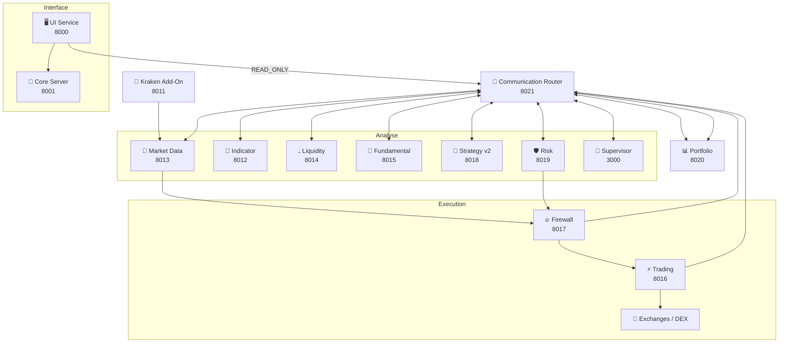
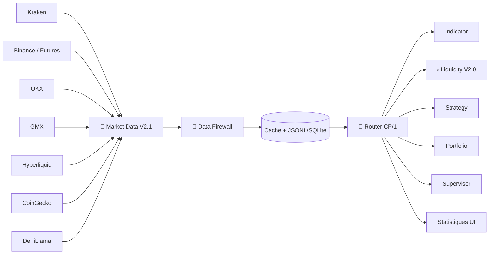
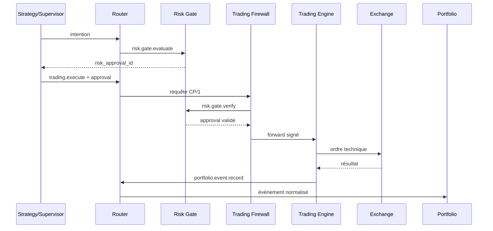

# 🏗️ Architecture IA-TB V2.0 DEBUG

> **🟢 En simple : IA-TB fonctionne comme une équipe de spécialistes. Market Data collecte, Indicator calcule, Fundamental renseigne, Strategy propose, Risk contrôle, Trading exécute, Portfolio mémorise et Supervisor orchestre. Le Router sert de standard téléphonique central.**

Cette page décrit l’architecture actuellement observable dans **V2.0 DEBUG**.

---

## 🧩 Architecture des processus

**🟢 En simple : chaque gros composant possède son propre service local et son propre port. Une panne d’un moteur ne doit pas obliger à fusionner tout le système dans un seul processus.**

---

## 🔀 Router + CP/1

**🟢 En simple : les Engines ne doivent pas s’appeler directement entre eux. Ils envoient une requête normalisée au Router, qui vérifie où elle peut aller.**

Le protocole interne est **CP/1**. Les requêtes contiennent notamment :
- un `request_id` ;
- un `timestamp` ;
- une `target` ;
- une `action` ;
- des `arguments` ;
- un niveau de détail.

Le Router maintient un registre statique/dynamique, route les requêtes, publie des événements et applique des contrôles d’accès. L’authentification interne utilise un token CP et des signatures HMAC pour les chemins qui l’exigent.

Voir [Router Protocol / CP/1](Router-Protocol-CP1.md).

---

## 📡 Pipeline Market Data

**🟢 En simple : toutes les données de marché ou financières doivent entrer par Market Data. CoinGecko et DeFiLlama ne sont plus des services parallèles qui alimentent les Engines chacun de leur côté.**

CoinGecko est la référence du **marché token / registre d’actifs**. DeFiLlama est la référence des familles **DeFi protocol, DEX market et stablecoin DeFi**. Cette séparation évite les doublons inutiles.

**Liquidity Engine ne possède plus d’accès Internet pour les Market Data.** Les carnets Binance Futures/Hyperliquid/Kraken et l’Open Interest sont collectés par Market Data, inspectés par le Data Firewall, puis envoyés à Liquidity via Router/CP1. L’historique de microstructure est conservé en SQLite 30–90 jours côté Collector ; Liquidity ne garde qu’un cache court pour ses calculs.

---

## ⚡ Pipeline d’exécution Trading

**🟢 En simple : un ordre ne va jamais directement de l’IA à Binance/OKX/Kraken/GMX. Il doit obtenir une autorisation Risk, passer le Firewall, puis seulement être exécuté par Trading Engine.**

Le Trading Engine refuse une mutation qui n’a pas été forwardée par le Firewall. Le Firewall consomme/vérifie l’autorisation Risk avant transmission.

---

## 🤖 Supervisor et Strategy

**🟢 En simple : Strategy produit des intentions et le Supervisor rassemble le contexte et peut demander un raisonnement IA. Aucun des deux ne signe ni n’envoie directement un ordre.**

### Strategy Engine v2
- service actif sur `8018` ;
- catalogue de stratégies ;
- évaluation d’un contexte ;
- agrégation de résultats ;
- génération de `strategy.signal` ;
- mode `RUNNING` / `PAUSED` ;
- `INTENTION_ONLY`.

### IA Supervisor
- service actif sur `3000` ;
- collecte Market Data / Indicators / Fundamental / Liquidity / Portfolio / Strategy / Risk via CP/1 ;
- LLM configurable ;
- création/calcul d’indicateurs via Indicator Engine ;
- demande possible d’une autorisation au Risk Gate ;
- `INTENTION_ONLY`.

Le fichier de réglages V2.0 garde l’autonomous trading global sur **OFF** et le mode d’ordre sur **PREPARE_ONLY** par défaut.

---

## 🛡️ Risk Engine et Risk Gate

**🟢 En simple : Risk possède deux responsabilités distinctes : analyser le danger d’une situation et produire/vérifier une autorisation cryptographiquement contrôlée pour une intention d’ordre.**

Le Risk Engine calcule notamment le risque position/portfolio/stratégie. Il récupère son contexte via le Router.

Le **Risk Gate** ajoute une frontière d’autorisation :
- `risk.gate.evaluate` → examine une intention ;
- si autorisée, produit un `risk_approval_id` à durée limitée ;
- `risk.gate.verify` → vérifie l’ID et peut le consommer ;
- Trading exige cet ID pour les opérations mutantes.

Risk ne remplace pas le Firewall et ne parle pas directement à l’exchange.

---

## 📊 Portfolio Engine

**🟢 En simple : Portfolio est la mémoire financière de ce qui a réellement été exécuté et de l’état reconstruit du portefeuille.**

Portfolio reçoit les événements normalisés du Trading Engine, les déduplique/persiste, reconstruit positions et statistiques, maintient des snapshots et peut resynchroniser l’historique de Trading.

Le stockage est SQLite pour le moteur Portfolio. La page Portfolio ne reconstruit plus elle-même les trades : elle lit le service Portfolio via la passerelle UI/Router.

---

## 🏦 Banque

**🟢 En simple : la Banque est séparée de la chaîne décisionnelle Trading. Elle gère les wallets, les clés et les opérations blockchain destinées à l’utilisateur.**

Le Wallet Service génère actuellement :
- un compte **EVM** utilisable sur Ethereum, Arbitrum, Polygon, BNB Chain et Base ;
- un compte **Bitcoin** ;
- un compte **Solana**.

Les secrets sont chiffrés en **AES-256-GCM** et rattachés au client. Les transferts sont dispatchés vers trois modules : ERC20/EVM, Bitcoin et Solana.

Voir [Banque IA-TB](Bank.md).

---

## 🖥️ Séparation UI / Core

**🟢 En simple : le navigateur n’est pas considéré comme un Engine de confiance. Il passe par un service UI dédié et reçoit principalement des accès en lecture.**

Le service UI sur `8000` :
- sert les pages ;
- contrôle les pages Admin ;
- proxy les API Core autorisées ;
- expose les lectures Router autorisées ;
- envoie les chandeliers par `/ui-data/market/candles`.

Le Core sur `8001` reste responsable des API applicatives, de la Banque, des paramètres, de l’authentification et de l’administration.

---

## 🧱 Ports de référence

| Composant | Port |
|---|---:|
| UI | 8000 |
| Core | 8001 |
| Kraken Add-On | 8011 |
| Indicator | 8012 |
| Market Data | 8013 |
| Liquidity | 8014 |
| Fundamental | 8015 |
| Trading | 8016 |
| Firewall | 8017 |
| Strategy | 8018 |
| Risk | 8019 |
| Portfolio | 8020 |
| Router | 8021 |
| Supervisor | 3000 |

---

## ⚠️ Incohérence documentaire/runtime détectée

**🟢 En simple : une ancienne métadonnée indique encore le mauvais port pour Trading, mais le vrai service Trading tourne bien sur 8016.**

Le fichier `Core/Communication/ProtocolRegistry/trading.json` indique actuellement `8017` dans son endpoint, alors que :
- le Process Registry déclare Trading sur **8016** ;
- `trading_service.js` écoute sur **8016** ;
- **8017** appartient au Firewall.

Le Wiki utilise donc **8016 comme source de vérité runtime**. La métadonnée du Protocol Registry devra être réalignée dans un chantier code séparé.

---

## ✅ Principes d’architecture

**🟢 En simple : une fonction doit passer par la bonne couche, conserver la provenance de ses données et ne pas contourner les contrôles de sécurité.**

1. Pas de dépendance Engine-to-Engine libre : utiliser Router/CP/1.
2. Les Market Data conservent leur source.
3. Une donnée absente n’est pas inventée.
4. Les opérations Trading mutantes exigent Risk + Firewall.
5. Le Supervisor et Strategy restent des producteurs d’intentions/analyses.
6. Les clés blockchain restent dans la Banque/Wallet Service.
7. L’UI obtient des droits limités, pas un accès backend arbitraire.
8. Les données utilisateur persistantes restent hors du dépôt Git.
