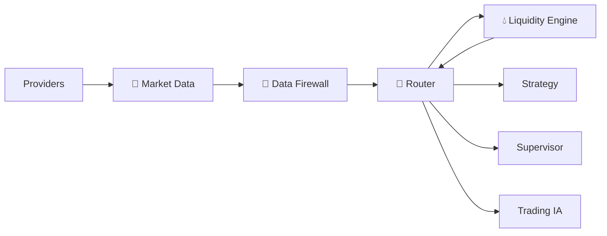

# 💧 Liquidity Engine — V2.0 DEBUG

> **🟢 En simple : Liquidity Engine cherche à répondre à “où se trouve la liquidité et à quel point le marché est-il profond ?”. Il complète l’analyse des prix avec profondeur, zones, open interest, liquidations et contexte DeFi lorsqu’ils sont disponibles.**

Le service écoute sur **8014** et utilise **CP/1**.

---

## 🎯 Fonctions actuelles

**🟢 En simple : le moteur peut produire une vue ponctuelle ou temps réel de la liquidité d’un symbole.**

Commandes principales :
- `liquidity.health`
- `liquidity.capabilities`
- `liquidity.zones`
- `liquidity.realtime`
- `liquidity.snapshot`
- `liquidity.liquidations`
- `liquidity.financial`

Données produites :
- `liquidity.snapshot`
- `liquidity.zones`
- `liquidity.orderbook`
- `liquidity.open_interest`
- `liquidity.liquidations`
- `liquidity.defi`

---

## 📡 Origine des données

**🟢 En simple : Liquidity ne doit plus contourner Market Data pour créer ses propres doublons de providers financiers.**

Les données financières CeFi/DeFi sont obtenues via **Router → Market Data Collector**. La commande `liquidity.financial` fournit une lecture orientée liquidité du snapshot central.

Les métriques spécifiques marché restent attachées à leur source. Une profondeur Binance ne devient pas une “liquidité globale” sans règle d’agrégation explicite.

---

## 🔄 Flux

---

## ⚠️ Donnée indisponible

**🟢 En simple : si un provider ne fournit pas une métrique, le moteur doit l’indiquer plutôt que l’inventer.**

Exemples :
- GMX peut fournir un prix Oracle sans volume natif comparable ;
- un Open Interest global ne doit pas être fabriqué à partir d’une source incomplète ;
- une liquidation nécessite une source adaptée.

Cette règle est commune à tout le pipeline financier IA-TB.
