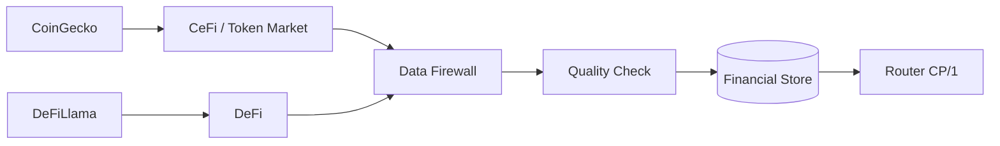

# 📡 Market Data Collector V2.0

> **🟢 En simple : Market Data est la porte d’entrée unique des données financières d’IA-TB. Il récupère les prix/bougies des marchés et les données CeFi/DeFi, garde la provenance, fait contrôler les données par le Firewall puis les distribue aux autres moteurs.**

Le service actuel écoute sur **8013** et annonce la version **2.0.0**.

---

## 🧭 Qui fournit quoi ?

**🟢 En simple : les providers se complètent. CoinGecko n’est pas utilisé pour remplacer DeFiLlama, et DeFiLlama n’est pas utilisé pour inventer des chandeliers d’exchange.**

| Provider | Rôle de référence V2.0 |
|---|---|
| 🐙 Kraken | OHLCV / volume natif |
| 🟡 Binance | OHLCV / volume natif |
| ⚫ OKX | OHLCV / volume natif |
| 🔵 GMX | prix Oracle / chandeliers, volume absent laissé absent |
| 🦎 CoinGecko | marché token, registre d’actifs, marché global, échantillon exchanges |
| 🦙 DeFiLlama | TVL, protocoles, chaînes, DEX, stablecoins |
| ⛓️ On-chain RPC | lecture générique EVM, jamais signature/envoi |

Le registre Candle actuel choisit explicitement parmi **KRAKEN / GMX / BINANCE / OKX**.

---

## 🦎 CoinGecko vs 🦙 DeFiLlama

**🟢 En simple : CoinGecko décrit surtout les tokens et le marché crypto global ; DeFiLlama décrit surtout l’activité DeFi. Cette séparation empêche de compter deux fois la même idée avec deux sources différentes.**

Le Collector déclare aujourd’hui la propriété suivante :
- `token_market → COINGECKO`
- `defi_protocol → DEFILLAMA`
- `dex_market → DEFILLAMA`
- `stablecoin_defi → DEFILLAMA`

CoinGecko alimente notamment :
- market cap global ;
- volume global/samples ;
- dominance BTC ;
- actifs principaux ;
- exchanges et volumes échantillonnés ;
- Market Registry.

DeFiLlama alimente notamment :
- TVL protocoles ;
- TVL chaînes ;
- volumes DEX ;
- capitalisation stablecoins ;
- classements protocoles/catégories.

Les limitations sont conservées dans le snapshot au lieu d’être masquées.

---

## 🧱 Validation par Data Firewall

**🟢 En simple : une réponse API n’est pas automatiquement considérée comme fiable parce qu’elle vient d’un provider connu.**

Avant stockage du snapshot financier, CoinGecko et DeFiLlama sont envoyés au Firewall via `/api/data/inspect`.

Le Data Firewall vérifie notamment :
- provider autorisé ;
- type de donnée autorisé ;
- provenance ;
- timestamp / fraîcheur ;
- schéma OHLC lorsque pertinent ;
- prix positifs ;
- bid/ask et spread ;
- doublons ;
- taille du payload.

Une forte variation de prix peut produire un warning sans supprimer arbitrairement un vrai mouvement de marché.

---

## 💾 Cache et historique

**🟢 En simple : les données récentes restent en mémoire pour être rapides, tandis qu’un historique financier léger est conservé sur disque pour les graphiques et analyses.**

Réglages par défaut actuels :
- refresh chandeliers : **15 s** ;
- cache Market Data : **48 entrées** ;
- TTL cache : **20 s** ;
- refresh financier : **60 s** ;
- TTL CeFi : **45 s** ;
- TTL DeFi : **90 s** ;
- persistance financière : environ **15 min** ;
- rétention : environ **30 jours** ;
- maximum historique : **1600 snapshots**.

Le Financial Store fonctionne en mode **HYBRID_MEMORY_JSONL** dans les données utilisateur hors dépôt Git.

---

## 📦 Snapshot financier V2

**🟢 En simple : Market Data fabrique un paquet cohérent qui réunit une partie CeFi et une partie DeFi, avec date, fraîcheur, qualité et provenance.**

Schéma courant : `iatb.financial.snapshot/2.0`.

Le snapshot n’invente pas :
- d’Open Interest si aucun provider dérivés n’est branché ;
- de liquidations si aucun provider approprié n’est branché ;
- de volume GMX absent ;
- de volume bridge non connecté.

---

## 🤖 Consommateurs

**🟢 En simple : une fois validées, les mêmes données peuvent être réutilisées par plusieurs moteurs sans rappeler CoinGecko ou DeFiLlama chacun de leur côté.**

Le service déclare comme consommateurs :
- Liquidity ;
- Indicator ;
- Strategy ;
- Portfolio ;
- Supervisor ;
- Chat IA en lecture ;
- Statistiques UI.

Les accès IA sont **READ_ONLY**.

---

## 📐 Indicator + données financières

**🟢 En simple : Indicator Engine peut maintenant calculer des métriques sur les séries financières persistées, pas seulement sur des chandeliers.**

Les commandes dédiées permettent :
- obtenir le contexte financier ;
- extraire une série numérique ;
- calculer variation, min/max, moyenne, SMA et EMA.

---

## 💧 Liquidity + données financières

**🟢 En simple : Liquidity peut enrichir son analyse avec le contexte financier centralisé au lieu de créer son propre connecteur DeFi parallèle.**

La commande `liquidity.financial` lit les données via Router/Market Data.

---

## 🧾 Principales commandes CP/1

**🟢 En simple : le Router expose des commandes de lecture standard plutôt que de laisser les autres moteurs connaître l’implémentation interne du Collector.**

- `marketdata.health`
- `marketdata.audit`
- `marketdata.candles`
- `marketdata.providers`
- `marketdata.registry.*`
- `marketdata.financial.capabilities`
- `marketdata.financial.snapshot`
- `marketdata.financial.history`
- `marketdata.financial.ai_context`
- `marketdata.financial.storage`
- `marketdata.financial.refresh`

---

## 📊 Page Statistiques

**🟢 En simple : les graphiques CeFi/DeFi de Statistiques utilisent désormais les snapshots du Market Data Collector.**

La page appelle `marketdata.financial.snapshot` et les historiques CeFi/DeFi via le canal UI READ_ONLY, avec un rafraîchissement d’environ 60 secondes.

Attention : certaines petites cartes décoratives de disponibilité/latence restent encore des valeurs de présentation tant qu’aucune métrique runtime équivalente n’est fournie.

---

## ⚠️ Anciennes fonctions / documentation historique

**🟢 En simple : l’ancien Wiki parlait beaucoup d’Hyperliquid et de la source virtuelle ƒx. Ce n’est pas le chemin principal du Market Data Collector V2.0 actuellement chargé.**

Les anciens développements restent utiles dans l’historique Git, mais la documentation V2.0 considère comme pipeline canonique le registre actuel **Kraken / GMX / Binance / OKX + CoinGecko + DeFiLlama**.

---

## ✅ Règles obligatoires

**🟢 En simple : ne jamais mélanger silencieusement des marchés différents et ne jamais fabriquer une donnée manquante.**

- provenance conservée ;
- paire et timeframe validés ;
- volumes natifs seulement lorsqu’ils existent ;
- CoinGecko et DeFiLlama ont des rôles complémentaires ;
- données financières contrôlées avant stockage ;
- cache borné pour rester adapté à la machine cible.
